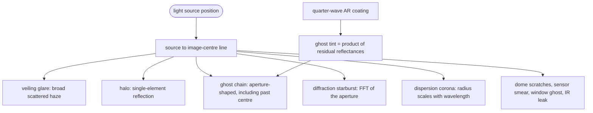

# `SunFlare`

> Compound, physically-motivated sun/light-source lens flare.

| | |
| --- | --- |
| Module | [`surmentations.lens.sun_flare`](../../src/surmentations/lens/sun_flare.py) |
| Stage | optics: in the lens |
| Needs depth | no |
| Annotations | untouched: the image only |

## Algorithm

## Model

Physically-motivated compound lens flare.

Real lens flare is not a single glow blob but the sum of several distinct
optical phenomena, all keyed off the line through the light source and the
image (optical) center:

1. **Veiling glare** — a broad, low-intensity haze radiating from the light
   source, caused by diffuse scattering inside the lens.
2. **Halo** — a ring at a roughly fixed angular radius from the light,
   caused by reflection off a single lens element.
3. **Ghosts** — a chain of scaled, recolored copies of the aperture shape,
   caused by light bouncing between multiple internal lens elements before
   reaching the sensor. Because each internal reflection roughly mirrors the
   ray through the lens's optical axis, ghosts line up along the
   light-source-to-image-center line, including *past* the center on the
   opposite side.
4. **Diffraction streaks** — radial spikes from the iris diaphragm's edges
   (an optional "star" pattern).
5. **Dispersion ring** — a narrow rainbow annulus. Unlike the halo this is a
   *diffraction corona* whose radius scales with wavelength, so it separates
   into spectral bands rather than being one tinted ring.

### Artefacts specific to surveillance cameras

The list above is what any lens does. A fixed CCTV camera adds its own, and
they are often the more recognisable half of the picture — footage is
identifiable as surveillance footage largely by these:

6. **Scratches on the dome or window.** Almost every fixed camera looks
   through an acrylic dome or a weather window, and those get scuffed by
   cleaning, grit and UV ageing. A scratch scatters light perpendicular to
   its own length, throwing a streak across the source. These are *not* the
   iris starburst: arbitrary angles, arbitrary count, unequal lengths, no
   symmetry.
7. **CCD vertical smear.** In an interline or frame-transfer CCD, a source
   bright enough to saturate a well leaks charge into the vertical shift
   register *during* transfer, smearing it uniformly down the entire column.
   The hard-edged full-height stripe through a streetlight is the signature
   artefact of older surveillance video. A CMOS sensor does not do this.
8. **IR-cut leakage.** A day/night camera swings its IR-cut filter out of the
   path at night, and silicon stays sensitive well past 700 nm where all
   three Bayer dyes leak — so hot sources bloom magenta-red, over a wider
   radius than the visible glare.
9. **Flat-window secondary ghost.** A plane protective window reflects a few
   percent at each face; the double bounce returns a faint displaced copy of
   the source. It does **not** lie on the source-to-centre line, because its
   offset comes from the window's thickness and tilt rather than from the
   optical axis — which is exactly how to tell it from a lens ghost.
10. **Onion-ring bokeh.** Concentric turning marks left on a moulded
    aspherical element by the diamond tool that cut its mould. Invisible in a
    focused image, they print straight through any defocused highlight, and
    they mark out the cheap moulded asphericals these lenses use.

### A source outside the frame

The sun does not have to be in the picture to flare it. A road camera looks
down, so the sun is more often just past the top edge or a side edge than in
the frame, and then its core never reaches the sensor. What does reach it is
the tail of the veiling glare and the ghosts, which lie on the line through
the image centre whether or not the source itself is imaged. That is the
commonest flare in daytime surveillance footage: one or two tinted polygons
on the road, on the far side of the centre from a sun that is nowhere to be
seen. The CCD smear is the one artefact that needs the source on the sensor,
since it is charge from the source's own pixels, so it is dropped then.

Ghosts are drawn as added radiance in linear light, after the rest of the
flare has been converted to it. The rest is built in sRGB-encoded units and
decoded as a whole, which suits the glare around the source; but decoding
crushes faint values (a ghost written at 7/255 adds 0.002 of full scale),
so a ghost drawn that way was visible only where the glare under it lifted
it, and one from a sun outside the frame, with no glare under it, was not
visible at all. In linear light a ghost's brightness is its own, wherever
it falls.

Reference: Hullin et al. 2011, "Physically-Based Real-Time Lens Flare
Rendering" (Eurographics/SIGGRAPH). This is a stylized, real-time-friendly
approximation of that model, not a full wave-optics simulation.

## Parameters

| Parameter | Default | Meaning |
| --- | --- | --- |
| `flare_position` | `None` | `(x, y)` in normalized `[0, 1]` image coordinates, or `None` to pick a random position each call: in the upper half of the frame, where light sources typically appear, or outside it with `off_frame_probability`. A position outside `[0, 1]` puts the source outside the frame, so that only its ghosts, the tail of its glare and any streaks reach the picture. |
| `off_frame_probability` | `0.5` | when the position is random, the chance the source is placed outside the frame, past the top edge or the upper half of a side edge. A camera looking down at a road sees the sun out of frame more often than in it, and the flare it gets then is ghosts alone. |
| `off_frame_reach_range` | `(0.03, 0.5)` | how far past the frame's edge that source sits, along the line from the image centre, as a fraction of the half-diagonal. |
| `intensity_range` | `(0.8, 1.9)` | overall brightness multiplier for the whole flare. |
| `ghost_count_range` | `(4, 10)` | number of internal-reflection ghost copies. |
| `ghost_strength_range` | `(0.08, 0.8)` | how much light a ghost of the reference size (4% of the diagonal) adds, in linear light at an intensity of 1, drawn per ghost on a log scale. Each pair of surfaces reflects a different share of the light, so ghosts in one flare differ by an order of magnitude. A larger ghost spreads the same light thinner, as the square of its size, and a ring-shaped one gathers it at the rim. |
| `halo_radius_range` | `(0.15, 0.35)` | halo ring radius as a fraction of the image's half-diagonal. |
| `streak_probability` | `0.75` | chance of rendering the iris-diffraction starburst. |
| `aperture_blades_range` | `(5, 9)` | number of aperture blades, drawn per call. Sets both the ghosts' polygonal shape and the starburst's spike count (N spikes for an even count, 2N for an odd one). |
| `dispersion_ring_probability` | `0.45` | chance of rendering the rainbow diffraction ring. |
| `dispersion_ring_radius_range` | `(0.22, 0.6)` | its radius as a fraction of the image's half-diagonal. |
| `dispersion_ring_intensity_range` | `(0.1, 0.35)` | how strong the ring is. This is the vividly rainbow-edged annulus seen in strongly flared frames: a diffraction corona thrown by the aperture edge and by dust on the elements, whose radius scales *linearly with wavelength*, so it separates into spectral bands rather than being one tinted ring. |
| `lateral_chromatic_range` | `(0.05, 0.3)` | lateral chromatic aberration on the ghosts, as a fraction of a ghost's own size. The lens magnifies each wavelength slightly differently, so a ghost's channels land at different *positions* as well as different sizes — which is what puts warm colour on one edge of a ghost and cool on the other. |
| `chroma_shift_range` | `(0.01, 0.05)` | how far the red and blue channels of a ghost are scaled apart geometrically, which fringes its *edges* with colour. |
| `coating_wavelength_range` | `(460.0, 620.0)` | the wavelengths (nm) the lens's anti-reflection coatings are designed to cancel. A single-layer coating can only null one wavelength, so the residual reflection either side of it is strongly coloured — and since a ghost is a product of two such residuals, this is where its tint actually comes from. Real coatings cluster around the middle of the visible band, which is why flare ghosts run violet/amber/cyan rather than any hue at all. |
| `onion_ring_range` | `(0.0, 0.22)` | depth of the concentric "onion ring" texture inside defocused highlights, left by the diamond-turned mould of a cheap aspherical element. A signature of small surveillance lenses; a ground element shows none. |
| `sensor_smear_probability` | `0.25` | chance of rendering CCD vertical smear. |
| `sensor_smear_strength_range` | `(0.05, 0.35)` | how bright that column is. |
| `sensor_smear_width_range` | `(1.5, 7.0)` | its width in pixels. The classic full-height stripe through a bright light in older surveillance footage — charge leaking into the vertical shift register during transfer, so it is uniform down the whole column and hard-edged. Set the probability to 0 to model a CMOS camera, which smears differently (rolling-shutter skew) and not like this. |
| `scratch_count_range` | `(0, 7)` | number of scratch streaks from a scuffed dome or weather window. Distinct from the iris starburst: arbitrary angles, arbitrary count, unequal lengths — a scratch scatters light perpendicular to its own length, and no two scratches match. |
| `scratch_strength_range` | `(0.04, 0.3)` | how brightly those scratches scatter. |
| `ir_leak_probability` | `0.3` | chance of rendering IR-cut leakage. |
| `ir_leak_strength_range` | `(0.05, 0.3)` | its strength. A day/night camera swings its IR-cut filter out at night and silicon stays sensitive past 700 nm, so a hot source blooms magenta-red over a wider radius than the visible glare. |
| `window_ghost_probability` | `0.35` | chance of a flat-window secondary ghost. |
| `window_ghost_offset_range` | `(0.03, 0.14)` | its displacement as a fraction of the half-diagonal. A plane protective window reflects a few percent at each face and returns a faint displaced copy of the source — **not** on the source-to-centre line, since the offset comes from the window's thickness and tilt rather than from the optical axis. |
| `p` | `0.5` | probability that the transform is applied |

## Samples

Severity 1 to 5, left to right, from the severity gallery.

`sun_flare`

| 1 | 2 | 3 | 4 | 5 |
| --- | --- | --- | --- | --- |
|  |  |  |  |  |

## References

- Hullin, M., Eisemann, E., Seidel, H.-P. and Lee, S. (2011). Physically-based real-time lens flare rendering. *ACM Transactions on Graphics* 30(4) (SIGGRAPH). [doi:10.1145/1964921.1965003](https://doi.org/10.1145/1964921.1965003)
- Talvala, E.-V., Adams, A., Horowitz, M. and Levoy, M. (2007). Veiling glare in high dynamic range imaging. *ACM Transactions on Graphics* 26(3) (SIGGRAPH). [doi:10.1145/1275808.1276424](https://doi.org/10.1145/1275808.1276424)

---

Generated by [`docs/make_transform_pages.py`](../make_transform_pages.py) from the source; edit the docstring or that script, not this page. [All transforms](README.md).
