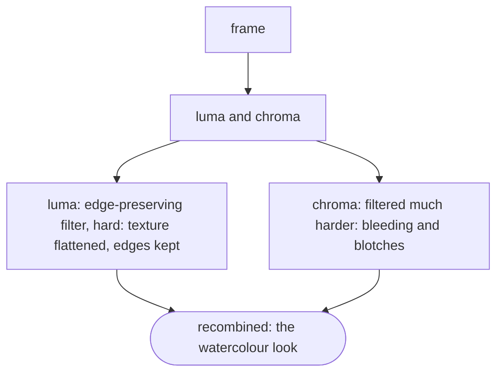
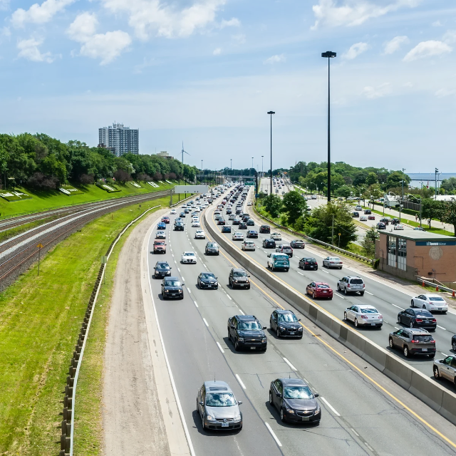
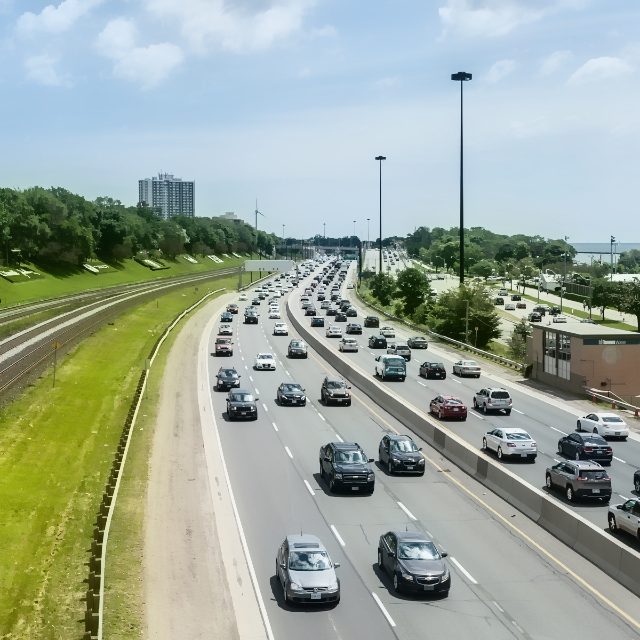
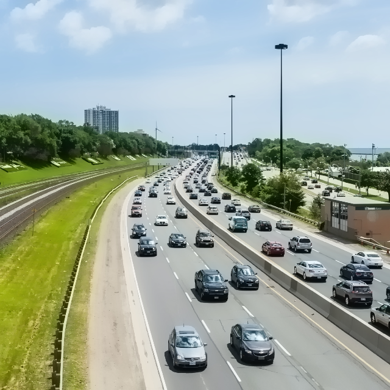

# `TemporalDenoiseArtifacts`

> The "watercolour" flattening and chroma blotching left by 3D-NR.

| | |
| --- | --- |
| Module | [`surmentations.camera.denoise`](../../src/surmentations/camera/denoise.py) |
| Stage | processor: noise reduction |
| Needs depth | no |
| Annotations | untouched: the image only |

## Algorithm

## Model

Artefacts left by a surveillance ISP's noise reduction.

### Physical model

At night a camera's sensor gain is high and the raw image is very noisy, so
the ISP denoises hard. Consumer and surveillance ISPs use "3D-NR": a spatial
edge-preserving filter combined with a temporal average across frames. Both
halves leave a signature, and both destroy exactly the fine detail that
detectors depend on.

**The spatial half**, which a single image *can* express and which is most of
the damage: an edge-preserving filter run aggressively does not blur the
image uniformly. It collapses low-contrast texture into flat patches while
leaving strong edges intact — the "watercolour" or "plastic" look. That is a
different operation from a blur, and the difference is the point: a blur
softens edges and texture alike, while this keeps the edges crisp and deletes
the texture between them. Any test that cannot tell those apart is not
testing this effect.

Chroma is denoised far harder than luma, because the eye is much less
sensitive to colour detail and the bit budget is better spent elsewhere. The
result is colour bleeding across boundaries and low-frequency chroma
blotching — visible as patches of wrong colour that do not line up with any
edge in the luminance.

**The temporal half is not single-frame and is not attempted here.**
Averaging across frames leaves comet trails behind anything that moved, and
the length of a trail is set by how far the object travelled between frames —
information a single image does not contain. Approximating it by smearing
high-gradient regions would be inventing motion that is not in the data. What
a clip-level API would add is exactly this: a per-frame displacement, from
which the trail follows.

## Parameters

| Parameter | Default | Meaning |
| --- | --- | --- |
| `strength_range` | `(0.4, 1.0)` | how far the result is pushed toward the fully denoised version. 0 is a no-op, 1 applies the filter outright. |
| `iterations_range` | `(1, 3)` | how many times the edge-preserving filter is run. Repetition is what turns a mild smoothing into flat patches — each pass pulls low-contrast neighbours closer together until they collapse to a single value, which a single strong pass does not do. |
| `edge_threshold_range` | `(18.0, 60.0)` | contrast below which detail is treated as noise and removed. This is the knob that separates this from a blur: edges above it survive intact however many iterations are run. |
| `spatial_radius_range` | `(0.004, 0.018)` | filter radius as a fraction of the image diagonal, i.e. how large the flat patches grow. |
| `chroma_blur_range` | `(0.004, 0.022)` | extra smoothing applied to the colour channels alone, as a fraction of the diagonal. Chroma is always denoised harder than luma, so colour bleeds across boundaries that luminance still resolves. |
| `p` | `0.5` | probability that the transform is applied |

## Samples

Severity 1 to 5, left to right, from the severity gallery.

`denoise_artifacts`

| 1 | 2 | 3 | 4 | 5 |
| --- | --- | --- | --- | --- |
|  |  |  |  |  |

## References

- Gastal, E. S. L. and Oliveira, M. M. (2011). Domain transform for edge-aware image and video processing. *ACM Transactions on Graphics* 30(4) (SIGGRAPH). [doi:10.1145/1964921.1964964](https://doi.org/10.1145/1964921.1964964)
- Tomasi, C. and Manduchi, R. (1998). Bilateral filtering for gray and color images. *IEEE International Conference on Computer Vision (ICCV)*. [doi:10.1109/ICCV.1998.710815](https://doi.org/10.1109/ICCV.1998.710815)

---

Generated by [`docs/make_transform_pages.py`](../make_transform_pages.py) from the source; edit the docstring or that script, not this page. [All transforms](README.md).
