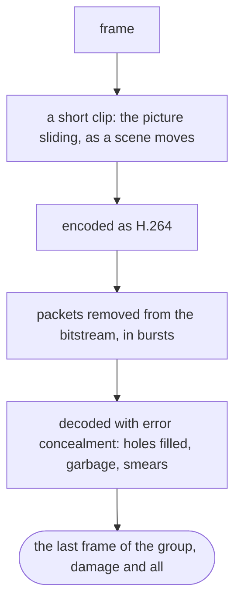

# `TransmissionFaults`

> Packet loss on an H.264 stream, decoded for real.

| | |
| --- | --- |
| Module | [`surmentations.camera.transmission`](../../src/surmentations/camera/transmission.py) |
| Stage | link: what it loses |
| Needs depth | no |
| Annotations | untouched: the image only |
| Tests | [`tests/unit/test_transmission.py`](../../tests/unit/test_transmission.py) |

## Algorithm

## Model

Packet loss: what a damaged stream decodes to.

`VideoCodecArtifacts` is compression — a stream that arrived whole. This is
the other thing a link does to a picture, and the one operators report: a
band of the frame that is out of date, smeared downwards, or filled with
blocks of the wrong colour. It is common on wireless and congested links,
where RTSP runs over UDP and a lost packet is simply gone.

Nothing here draws those artefacts. The transform **encodes a short H.264
clip, removes packets from the bitstream, and decodes what is left** with
the decoder's error concealment on, so what comes out is what a decoder
makes of that loss:

* **A slice whose packets are missing is concealed, or is not.** A decoder
  that conceals fills the hole from the last picture it has, shifted by its
  guess at the motion. On a still scene that is nearly invisible, which is
  the truth about packet loss and the reason it is noticed on moving things
  first. A decoder that does not conceal leaves the hole as the zeroed
  memory it is, and zero in YUV is green.
* **A slice that arrives with a gap in it decodes to garbage.** Everything
  after the gap is entropy-coded against state the decoder no longer has.
  It runs on, producing blocks of saturated colour, until it notices or the
  slice ends: damage starts mid-row and stops at a slice boundary.
* **With nothing to conceal from, it smears.** A decoder that joined the
  stream after an outage has no earlier picture, and fills a missing slice
  by stretching its neighbours' edges across it.
* **Damage persists.** Every later frame is predicted from the damaged one,
  so the fault stays, drifting and picking up corrections, until the next
  keyframe. The frame returned is the last of its group, however old the
  damage is by then.

What a single image cannot supply is the past. Concealment copies from an
earlier frame, and what makes that visible is the difference between then
and now. So the clip is built by sliding the picture: the reference frame
is the image displaced by `scene_motion_range`, and it moves into place
over the group. That stands in for a camera that swayed or a scene that
moved; the last frame is the image where it was given, so labels still
fit. It does not put a car where the car was two seconds ago.

### Cost

Two ffmpeg subprocesses and a clip of up to a handful of frames per call:
a few hundred milliseconds. Keep `p` low.

## Parameters

| Parameter | Default | Meaning |
| --- | --- | --- |
| `packet_loss_range` | `(0.01, 0.15)` | share of the stream's packets that are lost, drawn per call on a log scale. 0.01 is a link with a problem, 0.1 one that is barely usable. At least one packet is lost whenever this is positive. |
| `burst_length_range` | `(1.0, 4.0)` | mean number of consecutive packets lost each time loss occurs. 1 is independent loss; wireless fades run to several. |
| `frames_since_keyframe_range` | `(1, 5)` | how many frames into its group of pictures the returned frame is. Damage can strike any of them and stays until the next keyframe, so a larger number means more chances of damage, and older damage that later frames have partly drawn over. |
| `slices_range` | `(1, 6)` | slices each picture is coded in. A fault cannot cross a slice boundary within a picture, so this sets the height of the bands damage comes in: one slice, and a single lost packet can take the rest of the frame. |
| `crf_range` | `(24, 34)` | quality the stream is encoded at. See `VideoCodecArtifacts`. |
| `scene_motion_range` | `(0.0, 0.03)` | how far the picture moved between the reference the decoder conceals from and the frame returned, as a fraction of the image diagonal. Concealment copies old picture into new, and this is how wrong the old picture is. At zero most loss is concealed without a trace, as on a still scene it is. |
| `missing_reference_probability` | `0.15` | chance that the decoder has no earlier picture at all — it joined after an outage, or the loss took the previous keyframe too. Missing slices are then filled by smearing their surroundings and not by copying. |
| `concealment_probability` | `0.65` | chance that the decoder conceals what it did not receive. Software players do; many embedded decoders and recorders do not, and show the missing region as flat green. |
| `gap_passing_probability` | `0.5` | chance that the receiver hands the decoder a slice with a hole in it instead of cutting it off at the hole. This is what produces blocks of garbage. |
| `p` | `0.5` | probability that the transform is applied |

## Samples

Severity 1 to 5, left to right, from the severity gallery.

`transmission_faults`

| 1 | 2 | 3 | 4 | 5 |
| --- | --- | --- | --- | --- |
|  |  |  |  |  |

## References

- Wang, Y. and Zhu, Q.-F. (1998). Error control and concealment for video communication: a review. *Proceedings of the IEEE* 86(5), 974-997. [doi:10.1109/5.664283](https://doi.org/10.1109/5.664283)
- Wiegand, T., Sullivan, G. J., Bjøntegaard, G. and Luthra, A. (2003). Overview of the H.264/AVC video coding standard. *IEEE Transactions on Circuits and Systems for Video Technology* 13(7), 560-576. [doi:10.1109/TCSVT.2003.815165](https://doi.org/10.1109/TCSVT.2003.815165)

---

Generated by [`docs/make_transform_pages.py`](../make_transform_pages.py) from the source; edit the docstring or that script, not this page. [All transforms](README.md).
