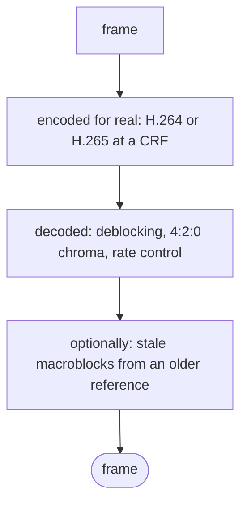
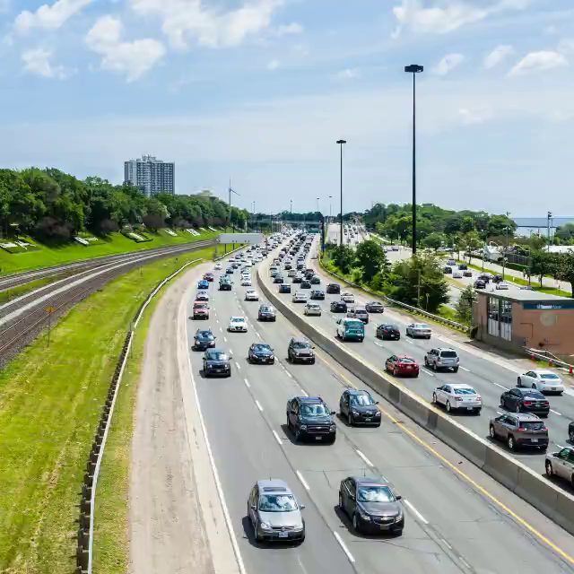
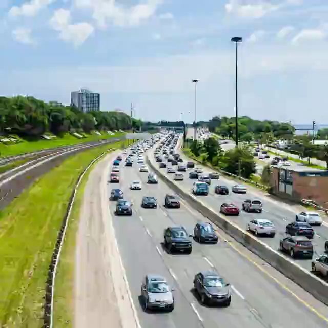
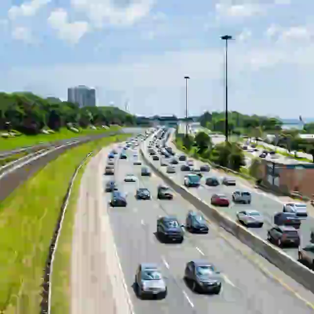

# `VideoCodecArtifacts`

> H.264/H.265 compression at a target quality, encoded for real.

| | |
| --- | --- |
| Module | [`surmentations.camera.codec`](../../src/surmentations/camera/codec.py) |
| Stage | link |
| Needs depth | no |
| Annotations | untouched: the image only |

## Algorithm

## Model

Video-codec artefacts, produced by actually encoding rather than approximating.

### Why not JPEG

Augmentation pipelines reach for JPEG compression to stand in for "the image
was compressed". For a surveillance stream that is the wrong artefact. A
stream is H.264 or H.265 at a low bitrate, and it fails differently in ways
that matter:

* **A deblocking filter runs inside the codec.** H.264 smooths its own block
  boundaries as part of decoding, so the result is not the hard 8x8 grid JPEG
  leaves — it is blocky *and* smeared, with the smearing strongest exactly
  where the blocking would have been.
* **Chroma is subsampled 4:2:0** and quantised separately, so colour degrades
  faster than luminance and bleeds across edges. Saturated reds suffer worst.
  Measured on the reference photograph at CRF 30: luminance keeps 0.73 of its
  fine detail while the chroma channels keep 0.24 and 0.33. (This is a
  property of *natural* content — on synthetic images with uncorrelated
  channels, chroma carries as much real high-frequency structure as luma and
  the gap closes, which is why the unit tests do not assert it.)
* **Rate control decides the damage, not a quality dial.** The encoder spends
  its bits where its own model says they matter, so a busy frame is
  quantised harder than a flat one — the artefact is content-dependent in a
  way a fixed quality setting is not.

Rather than approximate any of that, this transform **encodes the frame with
ffmpeg and decodes it back**. Everything above then comes out correct for
free, including the parts an approximation gets wrong.

### Inter-frame damage

The other half of what a stream does to an image has no single-frame
equivalent at all: when a P-frame is lost, the decoder keeps displaying stale
macroblocks from an older reference while the rest of the picture updates, so
regions of the frame are *out of date* rather than merely degraded.

That is simulated here by compositing macroblock-aligned regions from a
second, much harder-quantised encode of the same frame. It is labelled a
stand-in and not presented as the real thing: genuine staleness needs the
previous frame, which a single image does not have. What it does reproduce
faithfully is the *spatial signature* — sharp macroblock-aligned boundaries
between regions of differing quality, which is what a detector actually trips
over.

### Cost

Two ffmpeg subprocesses per call, 150 ms or so, nearly all of it starting
them. That is expensive next to the array operations elsewhere in this
library, so keep `p` low rather than paying it on every sample, or install
PyAV (`pip install surmentations[codec]`): the frame is then encoded in
this process, in 10 ms for H.264 at 512 pixels, and for H.264 it is the same
frame to the byte. See `_inprocess`.

## Parameters

| Parameter | Default | Meaning |
| --- | --- | --- |
| `codec` | `'h264'` | `"h264"` or `"h265"`. H.265 holds detail better at the same bitrate but its artefacts are smoother and larger-scale, so the two do not look alike at matched quality. |
| `crf_range` | `(26, 40)` | constant-rate-factor range. Lower is better quality; 23 is the x264 default, and surveillance streams commonly run 28-38. |
| `stale_block_probability` | `0.25` | chance of simulating a lost reference frame. |
| `stale_block_fraction_range` | `(0.03, 0.25)` | fraction of the frame left stale when that happens. |
| `stale_crf_delta_range` | `(8, 18)` | how much worse the stale regions are, in CRF points. |
| `p` | `0.5` | probability that the transform is applied |

## Samples

Severity 1 to 5, left to right, from the severity gallery.

`video_codec`

| 1 | 2 | 3 | 4 | 5 |
| --- | --- | --- | --- | --- |
|  |  |  |  |  |

## References

- Wiegand, T., Sullivan, G. J., Bjøntegaard, G. and Luthra, A. (2003). Overview of the H.264/AVC video coding standard. *IEEE Transactions on Circuits and Systems for Video Technology* 13(7), 560-576. [doi:10.1109/TCSVT.2003.815165](https://doi.org/10.1109/TCSVT.2003.815165)
- Sullivan, G. J., Ohm, J.-R., Han, W.-J. and Wiegand, T. (2012). Overview of the High Efficiency Video Coding (HEVC) standard. *IEEE Transactions on Circuits and Systems for Video Technology* 22(12), 1649-1668. [doi:10.1109/TCSVT.2012.2221191](https://doi.org/10.1109/TCSVT.2012.2221191)
- List, P., Joch, A., Lainema, J., Bjøntegaard, G. and Karczewicz, M. (2003). Adaptive deblocking filter. *IEEE Transactions on Circuits and Systems for Video Technology* 13(7), 614-619. [doi:10.1109/TCSVT.2003.815175](https://doi.org/10.1109/TCSVT.2003.815175)

---

Generated by [`docs/make_transform_pages.py`](../make_transform_pages.py) from the source; edit the docstring or that script, not this page. [All transforms](README.md).
