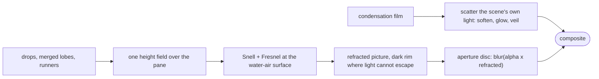

# `WaterDroplets`

> Drops, runners and condensation on the glass of a far-focused camera.

| | |
| --- | --- |
| Module | [`surmentations.lens.water_droplets`](../../src/surmentations/lens/water_droplets.py) |
| Stage | optics: on the glass or the housing |
| Needs depth | no |
| Annotations | untouched: the image only |

## Algorithm

## Model

Water on the camera's front glass: drops, runners and condensation.

### What the camera is looking at

A surveillance camera is focused metres away, and the water is on a pane a
few centimetres in front of its lens. Everything this module draws follows
from taking that seriously, and most of what synthetic rain-on-glass gets
wrong follows from not doing so — from drawing the window as a macro
photographer sees it, crisp beads each holding a tiny sharp picture.

**Defocus is set by the aperture, not chosen.** With the lens focused at
infinity, a point on the glass is imaged as a disc whose diameter, measured
on the glass, *is the diameter of the entrance pupil* — whatever the distance
between them. So a drop looks sharp only if it is much wider than the
aperture. Against the 2.5 mm pupil of a 4 mm f/1.6 lens, a 0.6 mm bead is
spread over seventeen times its own area and survives as a 6% dip in local
contrast; only drops of several millimetres remain as soft blobs. Stop the
iris down to 0.5 mm in daylight and the same drops are nearly crisp. That is
why `aperture_diameter_range_mm` replaces a free "defocus" knob, and why
the same wet glass looks so different by day and by night.

The image is formed accordingly. Every ray through the pupil that reaches a
given pixel crosses the glass somewhere inside that disc; where it crosses
clear glass it sees the scene in the pixel's own direction, undisturbed, and
where it crosses water it is bent and sees somewhere else. So:

``
out = (1 - blur(alpha)) * scene + blur(alpha * refracted)
``

with `blur` the aperture disc. Small drops do not get blurry *pictures* in
them; they fade into the scene behind.

**All the water is one surface.** Drops are not drawn one at a time. Each is
a lobe of a single height field over the pane, and lobes that touch merge
through a smooth union, so two drops caught mid-coalescence form a peanut,
and a runner is an outline drawn row by row — a slug, a pear, or a head
trailing a thread that swells and breaks into beads — so no two are alike.
How far any drop departs from a round cap follows its size against the
capillary length: fine beads are round because surface tension makes them
so, and large drops are lopsided and bottom-heavy. Refraction is then one remap of the
whole frame through the field's slope: Snell's law at the water-air surface
gives the deflection, the focal length in pixels turns it into an offset, and
because a convex surface deflects towards its own centre the picture inside
every drop comes out inverted and squeezed, with no "compression" parameter.
The dark outline is not painted either. Past 48.8 degrees of surface tilt the
ray cannot leave the water at all — total internal reflection — and looks
back into the housing.

**Nothing is lit by a light that is not there.** A camera behind the glass
never sees a specular highlight off the outside of a drop; that reflection
leaves in the other direction. What it sees as a glint is the *refracted
image of a bright source*, so glints here are refracted, their brightness is
relative to the scene's own brightest light, and at night there are none
unless there are lamps. The one light that does come from the camera is its
infrared ring, which is handled separately: see `illuminator_glow_range`.

### Condensation

The droplets of a condensation film are tens of micrometres across — orders
of magnitude below the aperture disc — so they can only ever appear as
scattering. Scattering *redistributes* the light arriving at the glass: most
of it into a narrow forward lobe, which softens, and the rest into a long
tail, which puts a glow round every light and a veil over the frame. All of
it is computed from the scene, in linear light. That is
the whole difference between a fogged lens by day (a milky loss of contrast,
because the wide lobe averages a bright scene) and at night (a frame that
stays dark, with every lamp carrying a large glow). Blending towards a fixed
white instead adds light from nowhere: on a night street it raised the
fogged areas from level 35 to level 102.

Where the film sits is decided by the temperature of the glass, which varies
smoothly: it clears outward from wherever the glass is warmest, so the film
is one region with one ragged front, not scattered patches.

### Shedding

Whether a drop runs is still derived rather than drawn: it slides once its
weight beats contact-line pinning, at a radius set by the capillary length.
A runner's track meanders, because the contact line jumps sideways when it
meets a pinned drop or a dirty patch; it wipes the film off the glass as it
goes, swallows the drops in its path, and leaves a few beads behind.

References: Garg & Nayar on adherent drops; You et al. 2013 ("Adherent
Raindrop Detection and Removal in Video") for the aperture-disc image
formation; Halimeh & Roser 2009 for refraction through a drop on a
windscreen; Qian et al. 2018 ("Attentive GAN for Raindrop Removal"); and the
height-field treatment of merging drops in Lucas Bebber's WebGL rain
(tympanus.net/codrops/2015/11/04/rain-water-effect-experiments/).

## Parameters

| Parameter | Default | Meaning |
| --- | --- | --- |
| `droplet_count_range` | `(180, 520)` | number of droplets to *attempt* to place. Fewer may render if the canvas cannot fit them without overlap, or if a runner has swept them up. |
| `droplet_radius_range` | `(0.0016, 0.03)` | droplet radius, as a fraction of the image diagonal (0.01 on a 1000px-diagonal image is a 10px radius). |
| `size_exponent_range` | `(1.7, 2.4)` | exponent `tau` of the `N(r) ~ r^-tau` drop-size power law, drawn per call. Coalescence-driven growth settles near `tau = 2`; larger values push the distribution toward fine spatter, smaller ones toward a few big beads. |
| `pane_width_range_mm` | `(30.0, 190.0)` | physical width of the piece of glass the frame covers, drawn per call. This gives droplet sizes a real scale, which two things depend on: whether a drop is heavy enough to run (its size in millimetres against the capillary length), and how defocused it is (its size against the aperture). |
| `aperture_diameter_range_mm` | `(0.5, 3.0)` | diameter of the lens's entrance pupil, drawn per call. **This is what sets how sharp the water looks.** Focused far away, the lens images every point on the glass as a disc this wide, so drops narrower than the aperture dissolve into a loss of contrast and only wider ones keep an outline. A 4 mm f/1.6 lens is 2.5 mm; the same lens with its iris stopped to f/8 in sunlight is 0.5 mm. Fixed-iris cameras, and all cameras at night, sit at the wide end. |
| `horizontal_fov_range_deg` | `(60.0, 100.0)` | the camera's field of view, drawn per call. A drop bends rays through a fixed range of angles, so this decides how much of the frame each drop's inverted picture is taken from. |
| `contact_angle_hysteresis_range` | `(0.15, 0.65)` | `cos(theta_receding) - cos(theta_advancing)` for the glass, drawn per call. Higher means a stickier surface that pins larger drops in place; lower (a freshly coated dome) lets smaller drops run. |
| `cap_height_ratio_range` | `(0.35, 0.65)` | how far a drop bulges, as a fraction of its radius. Steeper drops bend rays harder and have a wider dark rim, because more of the surface is past the critical angle. Typical sessile water droplets: 0.3-0.6. |
| `coalescence_range` | `(0.1, 0.35)` | fraction of pinned drops caught merged with a neighbour. Two drops that touch become one, but on glass the contact line stays pinned where it was, so the merged drop keeps a lobed outline instead of relaxing to a circle. |
| `glint_range` | `(0.0, 1.0)` | brightness of the refracted image of a light source outside the frame, relative to the brightest light in it. Zero leaves the drops with only what the frame itself contains. |
| `illuminator_glow_range` | `(0.0, 0.0)` | how strongly the camera's own infrared ring lights the water, relative to full scale. Zero — the default — means the illuminator is off. On, the film scatters the ring's light back as a veil and every drop returns it from its rim, which is why a wet or fogged dome whites out at night. Set it only for frames that are in infrared mode; the shipped pipelines do. |
| `background_blur_range` | `(0.0, 0.0)` | defocus applied to the scene *outside* the droplets, as a fraction of the image diagonal. Above zero the camera is taken to be focused on the glass instead of the scene: the world goes soft and the water is drawn sharp, with no aperture disc. Leave at 0 for a surveillance camera. |
| `condensation_coverage_range` | `(0.15, 0.5)` | fraction of the pane that has fogged over. |
| `condensation_irregularity_range` | `(0.1, 0.4)` | how ragged the film's front is. Zero is a clean arc around the warmest point of the glass. |
| `condensation_edge_softness_range` | `(0.3, 0.6)` | width of the gradual fade at the film's front. |
| `condensation_milkiness_range` | `(0.25, 0.6)` | fraction of the light a full film scatters. What that does to the picture depends on the scene: it veils a bright frame and puts a glow round the lamps in a dark one. |
| `condensation_blur_range` | `(0.006, 0.02)` | width of the film's narrow forward scattering — how much it softens what is behind it — as a fraction of the image diagonal. |
| `trail_probability` | `0.35` | chance that a drop past the shedding threshold has already run some way, and so left a track. Pinned drops never do. |
| `trail_length_range` | `(0.08, 0.35)` | track length, as a fraction of image height. |
| `streak_length_range` | `(1.5, 3.0)` | how long a running drop is for its width. Which drops run is *derived*, not sampled — see `contact_angle_hysteresis_range`. What each one looks like within that length is drawn per drop: a blunt slug, a pear, or a head trailing a thread that swells and breaks into beads. |
| `vertical_stretch_range` | `(1.15, 1.5)` | how much gravity elongates a resting drop that is on the point of running. Smaller drops show less of it, in proportion to the square of their size, and small ones none. |
| `shape_irregularity_range` | `(0.03, 0.12)` | how far the outline of a drop one capillary length across (2.7 mm) departs from a circle, as a fraction of its radius. The departure scales with size, so fine beads stay round and large drops come out as the lopsided, bottom-heavy shapes their pinned contact lines leave them in. |
| `min_gap_ratio` | `0.12` | minimum gap between two separate droplets, as a fraction of their combined radii. |
| `p` | `0.5` | probability that the transform is applied |

## Samples

Severity 1 to 5, left to right, from the severity gallery.

`water_droplets`

| 1 | 2 | 3 | 4 | 5 |
| --- | --- | --- | --- | --- |
|  |  |  |  |  |

`night_droplets`

| 1 | 2 | 3 | 4 | 5 |
| --- | --- | --- | --- | --- |
|  |  |  |  |  |

## References

- You, S., Tan, R. T., Kawakami, R. and Ikeuchi, K. (2013). Adherent raindrop detection and removal in video. *IEEE Conference on Computer Vision and Pattern Recognition (CVPR)*, 1035-1042. [doi:10.1109/CVPR.2013.138](https://doi.org/10.1109/CVPR.2013.138)
- You, S., Tan, R. T., Kawakami, R., Mukaigawa, Y. and Ikeuchi, K. (2016). Adherent raindrop modeling, detection and removal in video. *IEEE Transactions on Pattern Analysis and Machine Intelligence* 38(9), 1721-1733. [doi:10.1109/TPAMI.2015.2491937](https://doi.org/10.1109/TPAMI.2015.2491937)
- Halimeh, J. C. and Roser, M. (2009). Raindrop detection on car windshields using geometric-photometric environment construction and intensity-based correlation. *IEEE Intelligent Vehicles Symposium*. [doi:10.1109/IVS.2009.5164347](https://doi.org/10.1109/IVS.2009.5164347)
- Roser, M. and Geiger, A. (2009). Video-based raindrop detection for improved image registration. *IEEE International Conference on Computer Vision Workshops*. [doi:10.1109/ICCVW.2009.5457650](https://doi.org/10.1109/ICCVW.2009.5457650)
- Qian, R., Tan, R. T., Yang, W., Su, J. and Liu, J. (2018). Attentive generative adversarial network for raindrop removal from a single image. *IEEE/CVF Conference on Computer Vision and Pattern Recognition (CVPR)*, 2482-2491. [doi:10.1109/CVPR.2018.00263](https://doi.org/10.1109/CVPR.2018.00263)
- Bebber, L. (2015). Rain & water effect experiments. Article, Codrops, 4 November 2015. [link](https://tympanus.net/codrops/2015/11/04/rain-water-effect-experiments/)
- Born, M. and Wolf, E. (1999). *Principles of Optics*, 7th edition. Cambridge University Press. [doi:10.1017/CBO9781139644181](https://doi.org/10.1017/CBO9781139644181)

---

Generated by [`docs/make_transform_pages.py`](../make_transform_pages.py) from the source; edit the docstring or that script, not this page. [All transforms](README.md).
