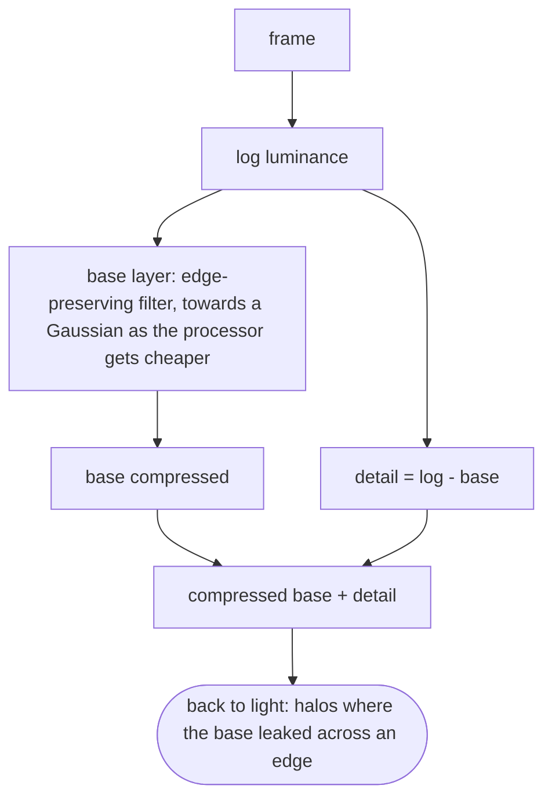
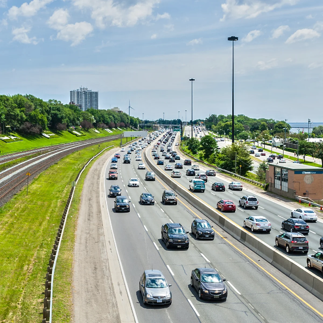
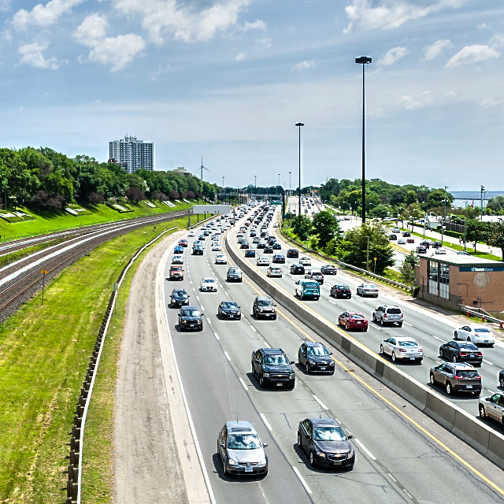
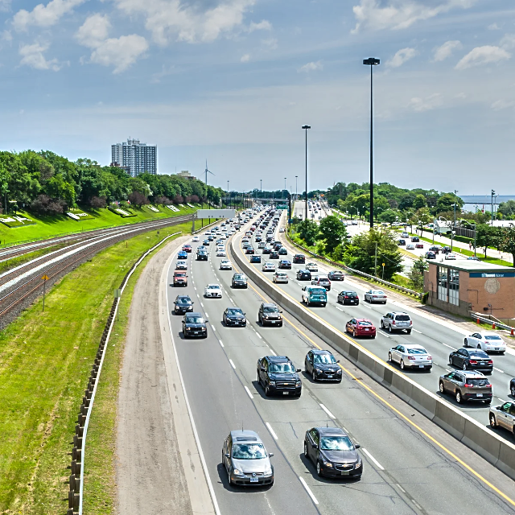
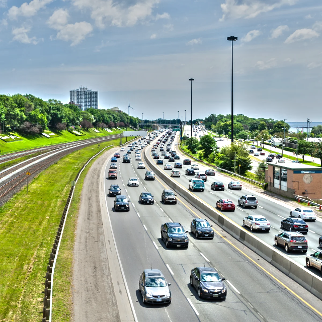

# `WdrToneMapping`

> Local tone mapping with the halos a cheap edge-preserving filter leaves.

| | |
| --- | --- |
| Module | [`surmentations.camera.tone_mapping`](../../src/surmentations/camera/tone_mapping.py) |
| Stage | processor: tone mapping |
| Needs depth | no |
| Annotations | untouched: the image only |

## Algorithm

## Model

Wide-dynamic-range local tone mapping, and the halos it leaves.

### Physical model

A surveillance camera routinely faces scenes no sensor can hold in one
exposure — a doorway against bright sky, headlights against an unlit street.
Its ISP therefore applies **local** tone mapping: it splits the image into a
slowly-varying *base* layer and a *detail* layer, compresses only the base,
and puts the detail back. Shadows lift and highlights survive while local
texture keeps its contrast.

The halos are not a bug bolted on afterwards; they fall out of how the split
is done. Separating base from detail needs an edge-preserving filter, and
edge-preserving filters are expensive, so embedded ISPs use cheap ones with a
finite range. At a strong edge the base layer *leaks* across it, so the
detail layer picks up a compensating overshoot — and once the base is
compressed and the two are recombined, that overshoot appears as a bright
band on the dark side of the edge and a dark band on the bright side. The
worse the filter, the bigger the halo.

That gives a knob with a real meaning rather than an arbitrary one:
`halo_strength` interpolates the base layer between a properly
edge-preserving filter and a plain Gaussian, i.e. between an expensive ISP
and a cheap one.

Working in log luminance is also not a stylistic choice. Tone mapping
compresses *ratios* — a lamp is not "200 units" brighter than a wall, it is
some factor brighter — and a ratio is a difference in log space, so the
base/detail split has to happen there to be scale-invariant.

## Parameters

| Parameter | Default | Meaning |
| --- | --- | --- |
| `compression_range` | `(0.45, 0.85)` | how hard the base layer's dynamic range is squeezed. 1 leaves it alone; 0.4 compresses the scene's range to 40% of its log extent, lifting shadows and pulling highlights down hard. |
| `detail_gain_range` | `(1.0, 1.6)` | how much the detail layer is boosted on the way back in. Above 1 is the over-crisp look of an ISP trying to hide the flattening the compression caused. |
| `halo_strength_range` | `(0.2, 0.8)` | how far the base layer leaks across strong edges, i.e. how cheap the filter is. 0 is a properly edge-preserving filter and almost no halo; 1 is a plain Gaussian and a pronounced one. |
| `filter_radius_range` | `(0.02, 0.07)` | base-layer filter radius as a fraction of the image diagonal. This sets the halo's *width* — the scale over which the base leaks. |
| `p` | `0.5` | probability that the transform is applied |

## Samples

Severity 1 to 5, left to right, from the severity gallery.

`wdr_tone_mapping`

| 1 | 2 | 3 | 4 | 5 |
| --- | --- | --- | --- | --- |
|  |  |  |  |  |

## References

- Durand, F. and Dorsey, J. (2002). Fast bilateral filtering for the display of high-dynamic-range images. *ACM Transactions on Graphics* 21(3) (SIGGRAPH). [doi:10.1145/566654.566574](https://doi.org/10.1145/566654.566574)
- Tomasi, C. and Manduchi, R. (1998). Bilateral filtering for gray and color images. *IEEE International Conference on Computer Vision (ICCV)*. [doi:10.1109/ICCV.1998.710815](https://doi.org/10.1109/ICCV.1998.710815)

---

Generated by [`docs/make_transform_pages.py`](../make_transform_pages.py) from the source; edit the docstring or that script, not this page. [All transforms](README.md).
