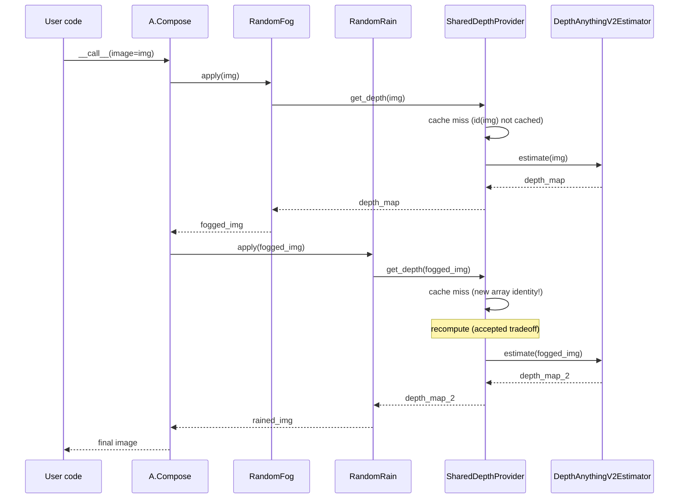
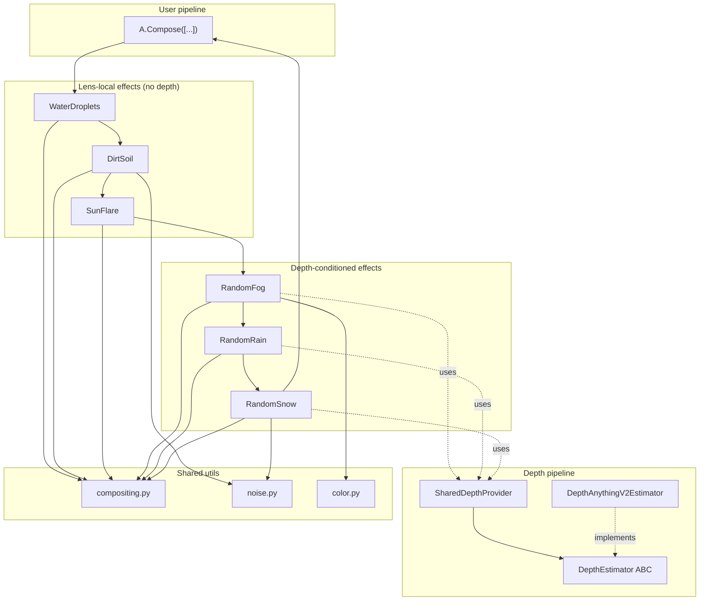

# weathermentations — implementation plan

Albumentations-compatible transforms for physically-grounded weather and lens
artifacts (fog, rain, snow, water droplets, dirt/soil, sun flare), for use as
training-time robustness augmentation.

## 1. Goals & non-goals

**Goals**
- Drop-in Albumentations `ImageOnlyTransform` subclasses, usable inside any
  `A.Compose([...])` pipeline.
- Physical models grounded in real formulas/papers, not ad-hoc filters —
  every effect's docstring cites the model it implements.
- Fast enough to run per-sample in a `DataLoader` worker for the depth-free
  effects; depth-conditioned effects require a GPU and say so loudly.
- Diverse, randomizable outputs suitable for robustness training, not
  necessarily indistinguishable from real photographs.

**Non-goals (v1)**
- Photoreal, production VFX-grade rendering.
- CPU-only depth estimation fallback (hard GPU requirement instead).
- Downstream robustness benchmarking (train/eval loops) — realism is
  validated visually and via unit invariants, not via a trained model's
  accuracy curve.
- Geometric transforms — nothing here moves pixels' semantic content, so no
  `DualTransform`/mask/bbox handling is needed.

## 2. Architecture

### 2.1 Package layout

```
weathermentations/
  __init__.py
  base.py                    # shared base classes / mixins
  depth/
    __init__.py
    estimator.py             # DepthEstimator ABC + DepthAnythingV2Estimator
    provider.py               # SharedDepthProvider (per-call cache)
  lens/
    water_droplets.py
    dirt.py
    sun_flare.py
  atmosphere/
    fog.py
    rain.py
    snow.py
  presets/
    severity.py               # SEVERITY[1..5] preset dicts per transform
  utils/
    color.py                  # airlight/atmospheric color estimation
    noise.py                  # perlin/simplex helpers for blob & flake shapes
    compositing.py             # alpha-composite, streak DB helpers
tests/
  unit/                        # physical-invariant tests
  visual_regression/
    golden/                    # fixed-seed reference PNGs
  qualitative/                 # notebooks/scripts comparing vs reference datasets
docs/
  examples/                    # generated sample images for README/docs
pyproject.toml
LICENSE                        # MIT
.github/workflows/ci.yml
.github/workflows/publish.yml
```

### 2.2 Base conventions

- Every transform subclasses `albumentations.ImageOnlyTransform`. No effect
  in scope changes geometry, so masks/bboxes/keypoints pass through
  Albumentations' `Compose` untouched with zero extra code.
- Constructor parameters are physical quantities expressed as `(min, max)`
  ranges, matching existing Albumentations conventions (`RandomRain`,
  `RandomFog`). A `p` argument controls the transform's own apply
  probability, as usual.
- `weathermentations.presets.SEVERITY[level]` (`level` 1–5, ImageNet-C
  style) returns a dict of kwargs per transform class that can be unpacked
  into its constructor — a convenience layer on top of the range API, not a
  separate code path inside the transforms themselves.
- Randomness goes through Albumentations' own `random_utils` /
  `self.random_generator` (per the modern Albumentations RNG API) so that
  global/pipeline seeding (`A.Compose(..., seed=...)`) controls these
  transforms exactly like built-in ones.
- torch is a hard dependency for the whole package (not just depth-aware
  transforms) — one code path, no optional-import branching.

### 2.3 Depth pipeline

- `DepthEstimator` is a small ABC: `estimate(image: np.ndarray) -> np.ndarray`
  (returns a relative depth map, same H×W, float32, larger = farther).
- `DepthAnythingV2Estimator` (small checkpoint) is the shipped default
  implementation, loaded via `transformers`/`timm`, `.eval()`, `cuda`-only.
- At construction, any depth-conditioned transform checks
  `torch.cuda.is_available()` and raises a clear, actionable error
  (`RuntimeError` with install/hardware guidance) if no CUDA device is
  present — no silent CPU fallback, since CPU inference would blow the
  training-step time budget this library exists to respect.
- **Sharing within one `Compose()` call**: depth is *not* cached across
  epochs/calls (decided against — no stable per-image id is available from
  a raw Albumentations call). Instead, a `SharedDepthProvider` instance is
  constructed once by the user and passed into every depth-conditioned
  transform's constructor (`RandomFog(..., depth_provider=dp)`,
  `RandomRain(..., depth_provider=dp)`, ...). Internally it holds a
  `maxsize=1` cache keyed on `(id(image), image.shape)`: the first
  depth-conditioned transform in the chain computes depth and caches it: any
  other depth-conditioned transform later in the same `Compose` call reuses
  it as long as the array identity hasn't changed. If an earlier transform
  in the chain happens to copy the array (cache miss), depth is simply
  recomputed — a graceful perf degradation, not a correctness bug, and an
  explicitly accepted tradeoff from the caching-strategy decision.
- **Superseded.** The `(id(image), image.shape)` key described above and
  drawn below had two defects the "accepted tradeoff" did not cover. `id()`
  is reused as soon as a frame is freed, so in a `Dataset.__getitem__` loop
  the cache *hit across samples* and served the previous frame's depth (51 of
  60 frames, measured) — a correctness bug, not a perf degradation. And since
  every transform returns a new array, the miss in the diagram is not an
  occasional case but every case: depth was never shared between two
  transforms that both fired. `depth/provider.py` now recognises a scene by
  weak reference plus a content fingerprint, and each transform carries the
  scene from its input to its output, so the second lookup below is a hit on
  the clean frame's depth.
- Depth values are relative (unitless); each depth-conditioned effect maps
  them into its own physical parameterization (e.g. fog's `beta` expects
  depth pre-scaled by a user-provided `depth_scale` to pseudo-meters, since
  monocular relative depth has no absolute scale).



### 2.4 High-level module architecture



## 3. Effect specifications

### 3.1 v1, phase 1 — Lens artifacts (depth-free)

#### Water droplets (`lens/water_droplets.py`)
- **Model**: each droplet is a small refractive lens (spherical-cap
  approximation, refractive index of water ≈ 1.33). For each droplet:
  compute a local surface-normal field from an assumed hemispherical/
  ellipsoidal profile, refract the *sampling ray* per Snell's law to get a
  distorted UV lookup into the source image (produces the characteristic
  inverted/magnified miniature-scene look inside a droplet), add a
  specular highlight (Blinn-Phong, single directional "sky" light), and
  darken the contact-line edge.
  Reference: droplet-as-lens models used in raindrop detection/removal
  literature (e.g. Qian et al. 2018 "Attentive GAN"; You et al. adherent
  raindrop modeling).
- **Params**: `droplet_count_range`, `droplet_radius_range` (px), `blur_range`
  for out-of-focus droplets, gravity `streak_probability` for
  elongated/sliding droplets.
- **Composite**: per-droplet distorted patch alpha-blended into the base
  image; streaks are a thin vertically-elongated variant of the same model.
- **Superseded.** The per-droplet patch above, its Blinn-Phong highlight and
  its painted rim describe a window photographed up close. For a camera
  focused metres away they were wrong in ways that showed on real scenes:
  drops far narrower than the lens aperture were drawn crisp (72-89% of them
  against a 2.5 mm pupil), every drop carried a +210 highlight from a fixed
  light whatever the scene, and the condensation veil blended towards white,
  which raised fogged areas of a night street from level 35 to 102.
  `lens/water_droplets.py` now builds one height field for all the water
  (lobes merge; pinned drops get size-dependent irregular outlines, and each
  runner is drawn row by row as a slug, a pear or a beading thread, on a
  meandering track), refracts
  the frame through it once with Snell and Fresnel, blurs the result with the
  aperture disc, and treats condensation as scattering of the scene's own
  light. `droplet_defocus_range` and `scene_compression_range` are gone;
  `aperture_diameter_range_mm` and `horizontal_fov_range_deg` replace them.

#### Dirt / soil (`lens/dirt.py`)
- **Model**: dirt on/near the lens sits far outside the camera's depth of
  field, so it renders as a heavily defocused, low-contrast, semi-opaque
  smudge, not a sharp mask. Generate blob shapes via clustered Perlin/
  simplex noise thresholding (`utils/noise.py`), then apply a large-radius
  blur (Gaussian or a bokeh-shaped kernel) to the blob alpha mask before
  compositing a brownish/grayish tint with reduced local contrast/
  saturation under the mask.
- **Params**: `blob_count_range`, `blob_size_range`, `opacity_range`,
  `color_range` (dirt/soil hue-saturation bounds), `defocus_blur_range`.

#### Sun flare (`lens/sun_flare.py`)
- **Model**: physically-motivated compound flare, not a single glow blob:
  (1) a veiling-glare haze radiating from the light source position, (2) a
  ring/halo at a fixed radius from the source, (3) a chain of "ghost"
  images — scaled, recolored (chromatic-aberration-shifted) copies of a
  soft circular aperture shape placed along the line through the image
  center and the light source, at positions mirrored past the center
  (models internal lens-element reflections), (4) optional radial
  diffraction streaks (star pattern) from an iris-diaphragm approximation.
  Reference: Hullin et al. 2011, "Physically-Based Real-Time Lens Flare
  Rendering".
  This supersedes Albumentations' existing simple `RandomSunFlare` additive
  circle with a compound, physically-motivated render.
- **Params**: `flare_position` (random or fixed), `ghost_count_range`,
  `halo_radius_range`, `intensity_range`, `streak_probability`.

### 3.2 v1, phase 2 — Depth pipeline

See §2.3. Deliverables: `DepthEstimator` ABC, `DepthAnythingV2Estimator`,
`SharedDepthProvider`, CUDA-required guard with actionable error message,
depth-scale calibration helper (`utils` function mapping relative depth →
pseudo-metric depth given a user `depth_scale` or a heuristic default).

### 3.3 v1, phase 3 — Fog / haze (`atmosphere/fog.py`)
- **Model**: Koschmieder's atmospheric scattering law:
  `I(x) = I0(x)·t(x) + A·(1 − t(x))`, `t(x) = exp(−β·d(x))`, where `d(x)` is
  (scaled) scene depth from the shared depth provider, `β` is the
  scattering/extinction coefficient, and `A` is the airlight/atmospheric
  color (estimated from the brightest, most desaturated image region, or a
  fixed near-white default).
- **Params**: `beta_range`, `atmospheric_light_range` (RGB or None for
  auto-estimate), `depth_scale`.
- **Invariant to test**: as `d(x) → ∞`, `I(x) → A`, monotonically in `d`.

### 3.4 v1, phase 4 — Rain (`atmosphere/rain.py`)
- **Model**: Garg & Nayar-style streak rendering — streaks as thin,
  near-vertical (± wind-angle), motion-blurred, semi-transparent
  highlights, alpha-composited over the image; streak length/width/blur
  modulated by a per-streak assigned depth (nearer drops → longer, more
  blurred streaks; farther drops → thinner, and at large depth streaks
  merge into a soft rain-veil haze layer, similar in form to the fog model
  but with a lower, rain-specific `beta`). Optional ground-wetness pass:
  darken + add horizontal specular sheen to the lower image band.
  Reference: Garg & Nayar, "Vision and Rain" (IJCV 2007);
  "Photorealistic Rendering of Rain Streaks" (SIGGRAPH 2006).
- **Params**: `streak_density_range`, `streak_length_range`, `angle_range`
  (wind), `brightness_range`, `veil_beta_range`, `wetness_probability`.

### 3.5 v1, phase 5 — Snow (`atmosphere/snow.py`)
- **Model**: particle system of flake sprites (soft circular/star kernels),
  count and per-flake size/blur modulated by depth (nearer = larger,
  more motion-blurred; farther = smaller, denser). Least "clean physics" of
  the four — flake fall/accumulation isn't a simple radiative-transfer
  law — so accumulation is handled as a separate, explicitly heuristic
  pass: a soft brightness/desaturation overlay on the lower image band
  (proxy for upward-facing, snow-catching surfaces), documented as a
  heuristic, not a physical claim.
- **Params**: `flake_density_range`, `flake_size_range`, `fall_angle_range`,
  `motion_blur_range`, `accumulation_probability`,
  `accumulation_strength_range`.

## 4. Validation strategy

Applies to every effect, each phase's checklist includes all four:

1. **Unit tests on physical invariants** — e.g. fog's monotonic
   approach to `A` with depth; alpha-compositing never leaves `[0,255]`;
   droplet refraction UV lookups stay in-bounds; flare ghost positions
   fall on the light-source/center line. Deterministic, fast, run in CI.
2. **Visual regression snapshots** — fixed-seed, fixed-input golden PNGs
   per transform × a few representative parameter settings, pixel-diffed
   in CI to catch unintended rendering changes (stability, not realism).
3. **Qualitative comparison against reference datasets** — side-by-side
   grids vs. real-condition photos during development (RESIDE for fog,
   Rain100/Raindrop for rain, a snow-scene subset for snow) — by-eye sanity
   check, not automated.
4. **Documentation sample generation** — a script that renders each
   transform at a spread of parameter values into `docs/examples/`, used
   directly in the README/docs.

No downstream robustness-benchmark training loop is in scope for v1.

## 5. Build order & roadmap


## 5b. Physical-realism overhaul (2026-09-11)

Feedback that the rendered results still looked unconvincing triggered a
research pass (Codrops/Heartfelt rain-on-glass lineage, Garg & Nayar rain
photometry, Koschmieder/Sakaridis fog, Hullin flare, Unreal/Unity dirt
masks) and a substantial rewrite. The findings that mattered were mostly
*physics errors*, not tuning:

**Cross-cutting**

- **Linear-light compositing** (`utils/photometry.py`). Scattering, flare and
  bloom all add radiance, which only adds linearly; doing it on sRGB values
  lifts mid-tones far too much. This alone was a large part of the "flat
  white wash" look. Every atmosphere/lens effect now de-gammas, works in
  linear light and re-encodes.
- **Depth was being converted wrongly.** Depth Anything emits *disparity*
  (~1/depth); the code did a **linear flip** (`1 - disparity`), which
  compresses the far field so badly that everything past the mid-ground
  collapses into one depth band — fog could then only ever be a flat wash.
  Now reciprocated: `depth = 1/(disparity + offset)`. On the reference photo
  this moved mean relative depth from 0.70 to 0.25, i.e. the scene is
  correctly mostly *near* with a genuinely distant horizon.
- **Resolution-independent sizing.** Size-like parameters are now fractions
  of the image diagonal rather than pixels, since a given physical feature
  subtends a fixed fraction of the field of view. Defaults tuned at one
  resolution no longer break at another.

**Water droplets** (the user's main reference: Codrops RainEffect /
"Heartfelt"). Rewritten around three things that were backwards or missing:

- The drop images an **inverted, demagnified** picture of the whole scene
  (a droplet is a ~2R-focal-length lens), not a slightly warped copy of what
  sits behind it.
- **Focus was inverted.** A camera that resolves drops is focused on the
  glass, so the *background* is out of focus and the *drops* are sharp. The
  previous version blurred the drop interiors and kept the world sharp.
- **The glass itself was missing**: real panes are fogged with thousands of
  tiny droplets, big drops leave **trails** of shrinking remnants, and those
  trails **wipe the mist clean** behind them. Added all three.
- Non-overlap is still enforced, now across trail droplets too, with the
  placement footprint inflated for gravity elongation (verified 0 violations
  across seeds).

**Rain.** Streak alpha was 10-50x too high. Garg & Nayar give
`alpha = tau/T = drop_diameter/streak_length` (scale-invariant, so usable
directly in pixels) — a few percent, not 30-60%. Streaks now take their
radiance from the scene's **sky** rather than being white, which makes them
contrast-dependent for free (invisible against bright sky, obvious against
dark foliage). Also: beaded intensity profile from drop oscillation, near
streaks **wider and dimmer** through defocus (was: brighter), and an
auto-exposure renormalisation.

Two real bugs found by measuring rather than eyeballing:
- Streaks were drawn straight onto a shared layer with `cv2.line`, which
  **overwrites**. In a dense field each streak erased its predecessors,
  usually replacing them with a dimmer modulated value — the accumulated
  rain collapsed to ~1/15 of what was drawn. Now rendered per-streak into a
  local patch and alpha-composited.
- A directional motion blur was applied *on top of* streaks that are already
  motion smears, dividing their alpha by the kernel length.

**Fog.** Wavelength-dependent extinction (`beta ~ lambda^-gamma`: thin haze
goes cool/blue, dense fog stays neutral), forward-scatter blur (fog is a
low-pass filter, not only a blend), and a sky cap so the sky keeps its
gradient instead of collapsing to flat airlight.

**Snow.** Added the atmospheric veil (the single strongest "it is snowing"
cue; snow scatters ~7x rain at equal rate), sky-radiance compositing, and
bokeh that is an **image of the aperture** — polygonal from the blade count,
bright-rimmed from spherical aberration, and clipped into cat's-eye lemons
off-axis by optical vignetting.

**Dirt.** Was "paint a translucent brown blob". Dirt does not tint, it
**scatters**: it now modulates a bright-pass of the scene through a wide
heavy-tailed PSF, so it is near-invisible in flat light and blazes when
backlit (verified by test), plus local contrast loss, wipe arcs and
coffee-ring water spots.

Still outstanding from the research: Hullin-style polygonal ghosts with
per-ghost coating tints and FFT starbursts for the flare (only the
linear-light fix landed), height-stratified fog, and Garg & Nayar's measured
streak database.

### Throughput benchmark (scripts/benchmark.py)

Added a benchmark that times each transform split into parameter sampling
(where depth estimation lands) and rendering, at several resolutions, and
reports the depth-conditioned transforms both cold and with depth already
cached. The split matters because depth is shared per `SharedDepthProvider`
and keyed on array identity, so naively timing one array repeatedly reports a
depth cost of ~zero.

It immediately found two performance defects, both fixed:

- **Dirt cost ~0.9 s/image at 1024px.** Its scatter PSF's widest Gaussian
  reached sigma ~300px, so OpenCV built a **1825x1825 kernel**. A blur that
  wide cannot carry detail finer than its own scale, so it is now computed on
  a downsampled copy and scaled back: 946 ms -> 115 ms, and the golden-image
  test still passes, confirming the result is visually identical.
- **Rain streak patches were ~5x oversized.** The per-streak bounding box
  reserved the streak's whole *length* as horizontal extent, when a
  near-vertical streak needs only a few pixels of width plus the bend. Now
  projected per axis: 567 ms -> 332 ms at 1024px.

Remaining: rain is still the slowest at ~2.5 img/s at 1024px, dominated by a
Python loop over thousands of streaks each issuing several OpenCV calls.
Batching that is the obvious next optimisation if it becomes a bottleneck.

### Fourth review pass — condensation and streak variety

The transform's target is a **surveillance camera focused metres away**, not
the Codrops demo's camera focused on the pane, and that distinction settles
both remaining complaints:

- **Mist was drawn as discrete droplets, which is impossible in this use
  case.** A condensation film's droplets are orders of magnitude smaller
  than the circle of confusion of a far-focused lens, so they can *never*
  resolve as specks — only as a milky veil. Rendering them individually is
  what made the spray look like uniform dots glued to the picture. Replaced
  with a *coverage* field: low-frequency value noise thresholded into
  irregular patches (condensation nucleates where the glass is coldest, so
  it forms in patches with clear glass between), which then drives a lerp
  toward a blurred, desaturated, brightened version of the scene. Patchy and
  milky rather than granular and even, and the tracks wiped by sliding drops
  still read because coverage goes to zero along them.
- **Rain streaks were too uniform.** Length, width and — critically —
  *defocus* are now drawn per streak rather than once per call, so a
  near-focus drop lands as a thin, bright, crisp stroke and an off-focus one
  as a wide, dim, soft smear. The first attempt added an independent blur on
  top of the existing circle-of-confusion term, which double-counted the
  same defocus and washed the field out; driving width, alpha *and* edge
  softness from one per-streak `coc` fixes that and is what the physics
  actually says.

### Third review pass — INRIA cross-check and lens rework

Cross-checked the rain photometry against the INRIA/astra-vision
`rain-rendering` code (Tremblay et al.). It **confirms the model**: their
drop radiance is `0.94 * avg_fov_lum + 0.06 * ambient_lum` (the same
refraction/reflection split used here), and their blend weight is
`length_opacity = d_avg / (length + d_avg)` — i.e. exactly the
diameter-over-length alpha used in `streak_alpha`, just written with the
`+d_avg` term that matters only when the streak is nearly as short as the
drop is wide. Their defocus step also pads the drop with a
`10*c` border *before* blurring, which is precisely the bug fixed below.

- **Droplet border artifacts.** The defocus blur ran on a tight bounding
  box, so the spread was truncated at the patch rectangle and every drop
  near an edge picked up a hard rectangular cut. Now padded by `3*sigma`
  (replicate for colour, zero for alpha) before blurring.
- **Mist/spray was haze, not spray.** Blur-plus-lift can only ever produce
  fog. The mist is now a *height field* whose gradient is used as a surface
  normal to displace the sampling position — the Heartfelt/Codrops
  normal-map trick — so each speck refracts like the tiny lens it is. That
  gives the granular sparkle of real spray, and because the tracks wiped by
  sliding drops have zero displacement, they finally read as clean.
- **Soil was blowing out.** The dirt used an unbounded additive bright-pass
  bloom, which *creates* light: over bright sky it saturated into flat white
  discs that looked like lens flare. Replaced with an energy-conserving lerp
  toward a normalised heavy-tailed scatter PSF, with highlights weighted up
  *inside* the scattered term. Same "invisible in flat light, awful when
  backlit" behaviour, but it physically cannot blow out.
- **Flare ghosts are now aperture images.** Polygonal (one side per blade),
  with a Fresnel-style bright rim and two damped inward ripples, drawn
  per-channel at slightly different scales for the coating's wavelength-
  dependent reflectance (chromatic fringing), at ~28% intensity since each
  bounce loses all but a couple of percent. The crude two-line cross was
  replaced by a real starburst with N spikes for an even blade count and 2N
  for an odd one.
- **Test gap closed.** Albumentations only *warns* about unknown constructor
  arguments, so a preset naming a renamed parameter silently fell back to
  defaults while the preset test still passed. The test now promotes that
  warning to an error.

### Second review pass (same day)

Reviewing the rendered examples caught a **variable-shadowing bug that had
silently broken rain entirely**: inside the per-streak loop the drop's width
was assigned to a local named `width`, clobbering the *image* width, so from
the second streak onward positions were drawn from `x ~ U(0, 13px)`. Every
streak piled into a white band on the left edge and the rest of the frame
got no rain at all. Renamed to `drop_width`. Worth remembering that the
symptom looked like a *tuning* problem ("rain too faint"), and two rounds of
parameter tuning went into it before measuring the actual streak coordinates
showed the real cause.

Also corrected in this pass:

- **Snow flakes were sized from the scene depth map.** A falling flake is in
  the air *in front of* the scene, so its distance is unrelated to whatever
  is behind it; tying the two made flakes look pasted onto surfaces (big
  over the near road, tiny over the distant sky). Each flake now samples its
  own distance from a volume-uniform distribution — `d = (1 + u*(ratio^3-1))^(1/3)`,
  size ~ 1/d — which yields the many-tiny-few-huge field real snowfall has.
  Two tests now pin this: sizes follow the volume distribution, and flake
  size is statistically independent of the depth behind it.
- **Droplet focus model flipped to the camera case.** The Codrops look
  (focused *on the glass*, background blurred) is right for an artistic
  rain-on-window shot but wrong for a dashcam or surveillance camera, which
  focuses on the distance: the scene stays sharp and the drops — sitting on
  the front element — go soft. `background_blur_range` now defaults to 0 and
  a new `droplet_defocus_range` softens the drops instead. The mist was also
  changed from a whitening wash to a local scattering texture, so the tracks
  wiped clean by sliding drops actually read.

## 5c. Second physical-realism pass (2026-09-14)

Feedback that snow, flare and rain still read as unconvincing, that the
droplets should match the Codrops distribution (keeping the far-field focus),
and that dirt should carry real chromatic variety. The through-line of this
pass is **replacing free parameters with derived ones**: wherever two
quantities are linked in reality, exposing both as knobs let a frame be
internally contradictory, and that inconsistency — not the tuning — was what
read as fake.

### Cross-cutting: physical units and derived quantities

New shared modules:

- `utils/precipitation.py` — Marshall-Palmer and Gunn-Marshall size
  distributions, Gunn & Kinzer terminal velocities, volume-uniform particle
  distances, frustum volume, number densities, and the visibility relations
  that give each precipitation type its extinction coefficient.
- `utils/spectral.py` — thin-film reflectance of a quarter-wave AR coating.
- `depth/normals.py` — surface normals back-projected from the depth map.

Rain and snow are now parameterised in **physical units** (mm, metres,
seconds, degrees of field of view) and projected through a pinhole camera,
which is what keeps a particle's size, defocus and motion smear consistent
with each other instead of being three knobs that can disagree.

Three things that used to be inputs are now consequences:

- **How many particles are in frame.** Number density (from the
  precipitation rate) times the volume of the simulated column. A count that
  contradicts the rate is no longer expressible.
- **How dense the veil is.** The veil *is* the particles too small to
  resolve individually, so its extinction comes from the rate via the
  standard visibility relations (`V = 1.9 R^-0.63` km for rain,
  `V = 0.6/R` km for dry snow). Setting it separately allowed a frame with a
  downpour's haze and a drizzle's streaks. A pleasing check on two
  independently-sourced relations: at equal rate they put snow's extinction
  at ~7x rain's, matching the separately-reported figure.
- **Which drops on glass slide.** From the capillary length, not a
  probability. See the droplets section.

Where the physically-correct particle count exceeds what can be rasterised
(a few cubic metres of rain holds hundreds of thousands of drops), the
render budget is converted into a **size cut** rather than truncating the
field: `size_cut_for_budget` solves for the diameter above which drops are
drawn individually. The drops that are drawn are then always the largest —
the ones that actually resolve — and the rest are, correctly, the veil.
Truncating the count instead would have made apparent intensity depend on
the render budget rather than on the weather.

### Bug found: the terminal-velocity fit was saturated

`terminal_velocity` returned **9.40 m/s for every drop from 0.5 mm up** —
more than 4x too fast for a small drop — because its constants had been
written for diameters in metres but the function took a radius in
millimetres. It went unnoticed for the obvious reason: *nothing called it*.
Streak length was drawn from an independent uniform range instead.

It is now Atlas & Ulbrich's fit, matches the Gunn & Kinzer table within 3%
across 0.5-5 mm, and is load-bearing — it sets streak length and, through
`alpha = D/(vT)`, streak opacity. A test pins it against the measured table.
The general lesson is the one worth keeping: dead code does not get
falsified by anything, so an unused physical constant is unverified by
default.

### Rain

- **Drops were sized from the scene depth behind them.** Exactly the error
  fixed for snow in the previous pass, still present here: `depth_factor`
  came from `relative_depth[py, px]`, so streaks shrank over distant sky and
  swelled over near road — pasted onto surfaces rather than falling through
  the air. Drop distance is now its own volume-uniform draw.
- **Length, width and opacity are no longer independent.** All three follow
  from one Marshall-Palmer diameter plus the exposure time. A big drop is
  both wider and faster, so it draws a longer streak, and `alpha = D/(vT)`
  falls out of the same two numbers.
- **Perspective convergence.** Rain falls along parallel world lines, and
  parallel lines project through a single vanishing point, so streaks
  **splay** whenever the camera is tilted — a strong cue that rain is
  falling *through* a scene rather than being drawn over it. It costs no
  parameter beyond the camera pitch, and a level camera recovers the
  parallel case exactly rather than special-casing it.

Honest limitation, measured rather than assumed: at a 60-degree field of
view and typical resolutions, a raindrop is **sub-pixel in width beyond
about two metres**, and `alpha = D/(vT)` is genuinely a few percent — so
individual streaks are subtle and the veil carries most of the intensity.
That is what the photometry says, and it is why the earlier "white
scratches" look was wrong. Narrowing the simulated column to favour near
drops was tried and measured *worse* (fewer drops, and nearer drops draw
longer and hence fainter streaks). Users wanting more conspicuous streaks
should raise the rain rate or use a narrower field of view; the severity
ladder does the former.

### Snow

- **Motion smear was one global blur for the whole flake layer**, which
  smears near and far flakes by the same number of pixels when the smear
  scales as `f v T / z` — the same `1/z` as the size. Each flake now carries
  its own, and because smear-to-size is `vT/D`, small flakes read as short
  dashes and large ones stay blobby. Flakes also **flutter**: per-flake
  direction jitter, without which the field reads as combed.
  The smear is a **Minkowski sum** of the aperture shape with the motion
  segment, which for a convex polygon is exact and free — each edge's
  supporting offset grows by the segment projected onto its normal — so it
  costs no convolution at all.
- **Bokeh is now the thin-lens circle of confusion**, `c = f A |1/z - 1/z_f|`,
  from a real aperture diameter and focus distance, replacing a
  `bokeh_strength` ramp. Peak coverage is the area ratio, so a flake against
  the front element renders as a large *translucent* disc and one at the
  focal plane as a small solid one, with no magic exponent.
- **Accumulation is no longer a brightened bottom band.** Back-projecting
  the depth map gives a surface normal per pixel, and what settles follows
  `max(0, n . up)` — Lambert's cosine law with falling snow in place of
  light. On the reference photo this picks out the road, individual car
  roofs, and the tops of the treeline while leaving lamp posts, the
  guardrail's face and the sky bare, which the band heuristic could not do
  at all.

  Two corrections found by rendering it: the cosine is the rate at which
  snow *arrives*, but staying put is a threshold (a coat slides off anything
  much past 45 degrees), so it is raised to a power — without which a
  60-degree wall kept half a covering and the whole frame washed flat white.
  And blending toward a constant white discards the scene's own lighting;
  the snow is now lit by a low-frequency estimate of local illumination, so
  a snow-covered road keeps its shadows and markings.

### Sun flare

All four items the previous pass left outstanding, done:

- **Ghost tints come from thin-film interference.** A quarter-wave AR
  coating can only null one wavelength, so its residual reflection is
  coloured, and a ghost — needing an even number of bounces — carries the
  *product* of two such residuals. The computed residual is ~1.3% against
  4.3% for uncoated glass, matching the quoted figure for single-layer
  MgF2, and the tints land in the narrow violet/amber/cyan band a real
  coated lens produces rather than anywhere on the hue wheel. Higher-order
  ghosts are both more saturated and fainter, which is why the strongly
  coloured ghosts in a real flare are the dim ones.
- **Ghost brightness goes as 1/area.** A ghost carries fixed flux however
  far it is defocused; giving every ghost the same per-pixel intensity made
  the large ones far too bright, which is what turned them into flat pasted
  discs.
- **The starburst is a real Fraunhofer diffraction pattern** — the squared
  magnitude of the aperture's Fourier transform — cached per blade count and
  rotated at use (exact, since rotating an aperture rotates its transform).
  It gets the spike count and parity right by construction (N spikes for an
  even blade count, 2N for odd; tested for 5/6/7/8 blades) and carries the
  per-spike fringe structure a synthetic `cos^90` cannot. It is sampled at a
  different scale per channel because diffraction angle scales with
  wavelength, which is what fans the spikes into colour.
  Its five-orders-of-magnitude core-to-spike range is tone-mapped, which is
  a display choice and documented as one — in a real photograph you only see
  the spikes because the core is blown far past saturation.
- **Veiling glare is a heavy-tailed Lorentzian**, the same scattering PSF
  family already used for lens grime in `dirt.py`. The old
  `(1 - r/r_max)^3` had no tail and hit exactly zero at the frame corner,
  putting a visible edge on the glare.

Also fixed by looking at the render: the halo was a 2%-wide Gaussian ring at
0.6 intensity — a crisp drawn annulus brighter than the source, which no
single-surface reflection is. It is now broad and faint. And the starburst
patch left a visible **rectangle** where its low-level floor was cut off at
the patch bounds; the pattern is now windowed to zero at its own edge.

### Water droplets

The brief was the Codrops/Heartfelt distribution with the far-field focus
kept (camera focused past the glass, drops defocused, scene sharp).

- **Sizes follow the dropwise-condensation power law** `N(r) ~ r^-2`
  (Family & Meakin; Rose), the self-similar regime coalescence-driven growth
  reaches — not a reshaped uniform. That is what puts hundreds of fine
  droplets on the glass for every large one, which is the texture the
  Codrops look is built from.
- **Sliding is derived, not sampled.** A drop runs once gravity beats
  contact-line pinning, i.e. above a radius set by water's capillary length
  (2.71 mm, reproduced by the code) scaled by contact-angle hysteresis.
  `streak_probability` is gone; which drops run now follows from the size
  distribution and the physical scale of the pane.
- **Only runners leave trails.** A trail *is* the record of a drop sliding —
  the shrinking remnants and the track wiped through the condensation — so
  pinned beads sprouting them put wiped tracks all over the pane with
  nothing that could have made them. This was also most of the render cost:
  fixing it cut droplet render time from 436 ms to 279 ms at 1024px and the
  droplet count from 2301 to 379.
- **Sliding drops are teardrops, not capsules.** The advancing (lower)
  contact line is blunt because it is continually wetting fresh glass; the
  receding one is dragged into a narrowing tail. A symmetric stretch reads
  as a drawn pill.
- Placement is vectorised throughout, so the field can carry hundreds of
  drops; the trail-overlap check was a per-element Python loop.

### Dirt

Dirt is not one substance and not one colour. Each smudge patch now draws a
deposit type with its own **single-scattering albedo** — mineral dust
(absorbs blue, scatters warm tan), clay soil (light brown), soot (the
canonical flat grey absorber), road film, limescale/sea salt (near-white and
barely absorbing), pollen (yellow-green) — and wipe arcs and dried water
spots carry their own. The albedo multiplies the scattered term rather than
being painted over the top, so a deposit both tints *and* dims what
scatters through it, and `1 - albedo` is what it absorbs; tint and
absorption stop being two separately-tuned layers.

This changed a test's premise and is worth recording. Grime's defining
behaviour — near-invisible in flat light, glaring when backlit — was
measured as mean absolute change, which now also picks up the few-percent
*uniform* dimming an absorbing deposit causes. That dimming is real (a
soot-covered window is darker) but it is exactly the part a camera's
auto-exposure cancels, and it is not what makes dirt conspicuous. The test
now measures the **spatial structure** the grime introduces, which is what
the claim was always about; measurement confirmed flat-light change is
almost entirely a uniform shift while the backlit case adds real structure.

### Throughput after this pass (1024px)

Re-benchmarked, since most of these changes are in hot paths:

| transform | before | after |
| --- | --- | --- |
| water_droplets | 470 ms | 214 ms |
| sun_flare | 102 ms | 63 ms |
| rain | 332 ms | 170 ms |
| snow | 259 ms | 303 ms |

Droplets got faster while carrying roughly six times as many drops, almost
entirely from the trails-only-for-runners fix — a physics correction that
happened to delete most of the work. Snow is now the slowest, from the
per-flake sprite loop; batching it is the obvious next optimisation if it
matters.

### Gaps knowingly left open

- ~~Rain streaks are subtle at wide fields of view.~~ **Superseded by 5d**:
  this conclusion was wrong, and instructively so. The measurement behind it
  was sound but it was measuring the wrong population — a diameter-based
  budget cut was discarding precisely the near drops that carry visible
  streaks, so "the physics says rain is subtle" was really "we are rendering
  the drops that cannot be seen". Worth remembering as a failure mode: a
  correct measurement of a wrongly-chosen subset reads exactly like a
  physical limit.
- Snow accumulation models no shelter: the underside of a bridge faces up
  and will collect snow it never would.
- Depth discontinuities back-project to surfaces nearly edge-on, which read
  as vertical and so receive no snow. Right answer, luck rather than design.
- The dirt qualitative comparison from Phase 1 is still open — no
  open-licensed photo of a dirty lens was findable.

## 5d. Visibility pass (2026-09-14, second round)

Feedback with six reference photographs: snowflakes and rain streaks had
**disappeared**, and the flare wanted more variety. The previous pass had made
the models self-consistent but left both precipitation types nearly invisible,
and rather than being a tuning failure this turned out to rest on two genuine
errors and one wrong question.

### Bug: snow size distributions are in *melted-equivalent* diameters

Gunn & Marshall — like every gauge-derived precipitation distribution — is
stated in the diameter of the water drop a flake would melt into. The code
used that number directly as the flake's optical size. But a snowflake is
mostly air, so what the camera sees is

    D_physical = D_melted * (rho_water / rho_snow)^(1/3)

which at a fresh-snow density of 0.05 g/cm^3 is **2.7x the diameter and
seven times the projected area**. The distribution was right; the unit was
wrong, and it made every flake too small to resolve. This is the same class
of error as the saturated velocity fit found in the previous pass: a physical
quantity carried in the wrong unit, invisible to every test that only checked
*relative* behaviour. `snow_density_g_cm3` is now a parameter, and severity
ramps it from wet compacted snow toward fresh dendrites.

### Bug: particle radiance was read off the frame, which may contain no sky

Streaks and flakes take their radiance from the scene's bright percentile,
because a drop is essentially an image of the sky. But **the sky is very often
not in the frame** — a camera angled down at a road sees none of it — and the
estimate then reads the brightest patch of *asphalt* as the illuminant, which
is several times too dark. The precipitation quietly vanishes, and it vanishes
worst in exactly the framing these transforms are most used on.

`illuminant_radiance_linear` now takes the brighter of the sky percentile and
the grey-world inversion `mean_luminance / 0.2`, recovering the illuminant
from a surface-only frame. Measured lift: 1.0x when sky is visible, 5x on a
road-only frame.

One consequence needed separating out: the *veil* must **not** use the lifted
value. Airlight is scattered skylight and saturates at the sky's own recorded
radiance, so compositing it toward an illuminant brighter than white blew the
sky out to flat white. Particles (directly lit, in front of everything) take
the illuminant; the veil takes the sky. They had been sharing one value.

### Wrong question: "which particles are big enough?" vs "which can be seen?"

The budget logic cut the population by **diameter**. But whether a particle
resolves depends on diameter *and distance together* — a large distant drop
and a small near one subtend the same angle — so a diameter cut discards
exactly the near particles that carry the visible texture while keeping far
ones that cannot be seen at all. That is why the previous pass measured "rain
is inherently subtle": it was rendering the wrong subset and concluding the
physics forbade the right one.

`resolvable_fraction` integrates `P(D > w0 z / f)` over the volume-uniform
distance distribution, and `sample_resolvable_particles` rejection-samples the
joint distribution conditioned on projecting wider than a threshold. The
rendered field keeps the correct near-large/far-small mix and simply stops
spending the budget on particles below a pixel.

Measured effect at 1024px: rain streak coverage at the top of the severity
ladder went from 0.71% to 6.5%; snow's median rendered flake radius went from
0.65px to ~2px with peak alpha from 0.06 to 0.42.

### Bug: the severity ladder was non-monotonic once the budget bound

With the render cap binding, coverage *peaked at severity 3 and then fell*.
Two causes, both worth recording:

- Truncating the count when the cap binds makes apparent intensity depend on
  the render budget rather than on the weather — the exact failure the earlier
  `size_cut_for_budget` note predicted, reappearing in a different place.
  `width_cut_for_budget` now raises the *width* threshold by bisection
  instead, so the streaks drawn stay the most visible ones.
- The preset tied **exposure time** to severity. Exposure is a property of the
  camera, not of the weather, and since `alpha = D/(vT)` a longer exposure
  draws longer and proportionally fainter streaks — so past the middle of the
  ladder the extra rain was cancelled by the extra blur. Severity now moves
  the precipitation rate alone.

Coverage is now monotonic across all five levels and pinned by a test.

### Flare variety

Every ghost in a real flare is formed by a different pair of surfaces, so it
sits at a different distance from focus with different aberration. Three
consequences, all visible in the reference photographs and none previously
modelled:

- **Rings as well as discs.** A ghost near focus images the iris as a solid
  patch; one far from focus concentrates light at the rim, because spherical
  aberration throws the marginal rays outward. `edge_gain` is now per-ghost.
- **The rings are the coloured ones.** Each bounce adds a pass of chromatic
  aberration, so high-order ghosts fringe hardest — this is where the
  rainbow-edged annulus in the first reference photo comes from.
- **Off-axis ghosts are elongated.** Astigmatism stretches a point into a
  short line, so the further along the flare axis a ghost sits the less
  circular it is.

The **veiling glare is also tinted** now, by the coatings' residual
reflectance — a single-pass scatter, so milder than a ghost's two-bounce
tint, but it is why the broad wash across a badly flared frame is so often
distinctly violet or amber rather than neutral white.

### Dead code, again

`sample_drop_diameters` and `sample_snow_diameters` were left unused once
resolvability sampling superseded them, and were deleted rather than kept.
The previous pass's own lesson applies: an unused physical helper is
unverified by default, and that is how the saturated velocity fit survived.

### Throughput

Re-benchmarked at 1024px: snow **302 -> 201 ms** (it no longer rasterises
sub-pixel flakes, so resolvability sampling paid for itself), rain 170 -> 218
ms (more streaks, and they are the visible ones), flare 63 -> 75 ms (per-ghost
astigmatism warp), droplets unchanged at ~220 ms.

### Calibration notes

Defaults that moved, and why — all chosen by measuring rather than by eye:

- Rain aperture 2-6mm -> 1.5-4.5mm and exposure shortened. A surveillance or
  dashcam lens genuinely has a small aperture (f/1.8 on a 4mm lens is 2.2mm),
  and the previous value was defocusing streaks into invisibility: the
  defocus term was dividing alpha by about three.
- Snow column 0.12-2.5m -> 0.12-5.0m. Beyond ~6m nothing is resolvable for
  rain either, measured — so the column is bounded by optics, not by guesswork.
- Snow rate default 5 -> 2.5 mm/h water equivalent. 10 mm/h is roughly 100 mm/h
  of actual snow depth, i.e. a blizzard whose veil alone drops visibility to
  tens of metres; the severity ladder reaches it at level 5.

## 5e. Per-call randomisation and flare dispersion (2026-09-14, third round)

### Every physical quantity now varies per call

An audit of the constructor signatures found **fourteen physical quantities
exposed as fixed scalars** across rain, snow and the droplets: rain rate,
snowfall rate, snow density, camera pitch, field of view, focus distance,
aperture blade count, cat's-eye strength, fall-speed scale, accumulation
patchiness and falloff, pane width, contact-angle hysteresis, and the drop-size
exponent.

This is a worse failure than it looks, and a quiet one. Each individual render
is perfectly fine — nothing about a single image says the rain rate was fixed.
What is lost is the diversity the augmentation exists to provide: a whole
training set gets one rain rate, one camera geometry, one kind of snow. It does
not show up in a visual check at all; it shows up much later as a model that
did not generalise.

All of them are now ``(min, max)`` ranges drawn per call. Measured effect on
snow across six seeds at fixed settings: flake count 86-582, veil transmission
0.38-0.84, aperture blades 6-9 — where before every call was identical.

What deliberately stays scalar, and why:

* ``*_probability`` — sampled against once per call; the probability *is* the
  knob, not a quantity needing its own range.
* ``max_streaks`` / ``max_flakes`` / ``min_*_width_px`` / ``flake_count_scale``
  — render budget and quality. Randomising these would make cost and fidelity
  random rather than the weather.
* ``min_gap_ratio``, ``definition_softness``, ``sky_optical_depth_cap`` —
  fixed model constants, documented as such where they are defined.

`tests/unit/test_randomization.py` guards the property rather than any value:
it introspects every transform's signature and fails on a physical scalar
outside an explicit allow-list, and it checks that different seeds give both
different pixels *and* different effect **strength**. The second matters
separately — a transform could place droplets in different spots every time
while always drawing the same number of them, which the pixel check alone
would pass. Verified non-vacuous: the signature guard does catch a
deliberately re-introduced scalar, and measured strength spreads are 0.14-0.48
against a 0.05 threshold.

Severity presets were updated to set the *centre* of each range rather than a
point, so a preset still picks how bad the weather is without collapsing the
transform to deterministic. The same rule is enforced in the docs generator via
a `_span` helper, for the same reason.

### Flare: dispersion is not tinting

The flare had chromatic *tinting* — thin-film coating colours on the ghosts —
but no chromatic **dispersion**, and they are not the same thing. The halo was
drawn as a single greyscale field multiplied by one colour, which can only ever
produce one coloured ring.

Added the missing phenomenon: a **diffraction corona**, thrown by the aperture
edge and by dust and coating texture on the elements, whose angular radius
scales *linearly with wavelength*. That is the vividly rainbow-edged annulus in
a real flare, and it is a different mechanism from the broad reflection halo,
which is essentially achromatic.

Getting it right needed a correction worth recording. Rendering the ring at the
three sRGB primaries — the same three samples used everywhere else in
``utils/spectral.py`` — produces **three separate red, green and blue rings
with gaps between them**, not a rainbow. Dispersion moves each wavelength to a
different *place*, so it has to be integrated over the band, not sampled at
three points. ``wavelength_to_rgb`` (the standard piecewise approximation to
the CIE colour-matching functions) supplies a colour per wavelength, and the
ring integrates 48 samples across 400-700 nm.

The general rule, now stated in the module docstring: **three samples are fine
when wavelength changes a thing's colour, and wrong when it changes its
position.**

Two details that follow from the physics:

* The ring's width is expressed as a *fraction of its radius*, because that is
  what sets how much the spectral bands overlap. Dispersion spreads the ring
  over about 0.55x its radius across the visible band, so a ring much narrower
  than that separates into hard primary arcs and one much wider washes to
  white; real coronae sit in between.
* The profile depends only on radius, so it tables into one dimension:
  48 wavelengths cost 48 passes over a 2048-entry array (~1 ms) instead of 48
  passes over the whole frame.

  It is deliberately *not* memoised, and the reason is worth keeping. An
  ``lru_cache`` went on it first, which looked obviously right — the profile
  is a pure function of two parameters. But those parameters are drawn from
  continuous ranges per call, so the key never repeats: measured over 40
  varied calls the hit rate was **0%**. A cache on a function whose arguments
  are freshly randomised every time is pure overhead wearing the costume of an
  optimisation, and quantising the key hard enough to collide would have to be
  coarse enough to see. It was removed.

Also added **lateral chromatic aberration** on the ghosts. Scaling each channel
only fringes a ghost's rim symmetrically; the lens also magnifies each
wavelength slightly differently, so the channels land at different *positions*
along the flare axis. That asymmetry is what puts warm colour on one edge of a
ghost and cool on the other.

One bug caught while wiring it up: the ring profile is normalised to a peak of
1, but the rest of the flare canvas accumulates on the same 0-255 scale as
``warm_white``. Dropping that factor made the ring contribute ~0.3 of 255 —
invisible, and easy to misread as the effect simply being too subtle rather
than as a units mismatch.

### Docs gallery

`sun_flare_fixed` is renamed `sun_flare`: the position has been randomised per
variant since the previous pass, so the name was actively misleading.

### Bug: rain was erased by its own anti-aliasing

The accumulated streak layer was softened with a Gaussian of sigma 0.7 px,
described in the code as "only a light cross-section softening". For a streak
one or two pixels wide that is not a cosmetic touch — it is a direct division
of the streak's peak opacity, and the streaks are *already* rasterised
anti-aliased by ``cv2.LINE_AA``, so most of it was re-softening something that
did not need it.

Measured at sigma 0.7 against 0.3: peak alpha fell from 0.100 to 0.058 and the
fraction of the frame carrying a visible streak fell by **two thirds**. Now
0.35, which keeps the accumulation smooth and gives most of that back. This
was the single largest visibility lever in the whole effect, and it had
nothing to do with the physics — it was a rendering constant quietly
cancelling the photometry.

Two smaller changes in the same direction, both physically motivated rather
than tuned:

* Aperture default 1.5-4.5 mm -> **0.9-2.6 mm**. Small apertures are realistic
  for the target cameras (f/1.6 on a 4 mm lens is 2.5 mm) and are the only
  lever that raises streak contrast *without* shortening the streaks, since
  defocus spreads a streak's fixed light over a wider band. Shutter time
  trades one against the other; aperture does not.
* ``min_streak_width_px`` 0.45 -> 0.40 with the budget raised to 16000, which
  admits the next tier of finer streaks.

Together: streak coverage at a fixed rate went from 2.5% to 4.1% before the
anti-aliasing fix, and roughly triples again after it.

### Severity level 1 must be mild, not absent

``SunFlare`` at severity 1 changed the image by **0.33 of an 8-bit level** on
average — invisible. A ladder whose bottom rung does nothing wastes a rung and
reads as a bug rather than as a setting. Its intensity floor is raised so
level 1 is a mild but visible flare, and the dispersion-ring probability now
rises with severity too.

Worth checking the same way for any future effect: render the level-1 preset
and measure it against the clean frame. "Subtle" and "absent" are easy to
confuse by eye and trivial to tell apart with a number.

### Rain rate bounds

``RandomRain`` validates ``rain_rate_range_mm_h`` against a floor of **2 mm/h**
and defaults to ``(5.0, 200.0)``. Two consequences worth stating explicitly,
since neither is obvious from the numbers:

* The floor of 2 mm/h means **drizzle is not expressible** (real drizzle is
  0.1-1 mm/h). Severity level 1 is therefore "light rain", not drizzle. Lower
  the bound if a drizzle regime is wanted.
* 200 mm/h is past any recorded *sustained* rainfall rate — roughly double the
  heaviest hour-long falls on record. It is a deliberate augmentation extreme
  rather than a weather value: at 200 mm/h the veil alone leaves ~5% of the
  light at the far plane, so the top of the range is effectively a whiteout.
  Measured across seeds at the default, streak coverage spans about 1% to 11%,
  which is the point of the wide range.

## 5f. Surveillance-camera flare artefacts (2026-09-14, fourth round)

The flare modelled what *any* lens does. A fixed CCTV camera adds its own
artefacts, and those are often the more recognisable half of the picture —
footage reads as surveillance footage largely because of them. Five added,
each with a physical mechanism rather than a look:

**Dome / window scratches.** Almost every fixed camera looks through an
acrylic dome or a weather window, and those get scuffed by cleaning, grit and
UV ageing. A scratch is a cylindrical scatterer: it spreads light in the plane
*perpendicular to its own length*. The distinction from the iris starburst
matters and is the whole reason this is a separate component — a starburst is
symmetric with a spike count fixed by the blade geometry, while scratch
streaks sit at arbitrary angles in arbitrary numbers with unequal lengths,
because no two scratches are alike. A frame showing a handful of unequal
streaks at odd angles is showing scratches, not diffraction.

**CCD vertical smear.** In an interline or frame-transfer CCD, a source bright
enough to saturate a well leaks charge into the vertical shift register *while
the frame is being shifted out*, so it is dragged uniformly down the entire
column. Two properties follow that no optical glow has, and the test pins
both: the stripe reaches the top and bottom edges of the frame, and it does
not fade with distance from the light. It is also near-achromatic, being a
charge effect rather than an optical one. A CMOS sensor does not do this at
all (it skews instead), so the probability is a knob rather than an always-on
component.

**IR-cut leakage.** A day/night camera swings its IR-cut filter out of the
path at night, and silicon stays sensitive well past 700 nm, where all three
Bayer dyes leak but green leaks least. Hot sources therefore bloom
magenta-red, and over a *wider* radius than the visible glare since IR
scatters further — so it is rendered as its own glow rather than as a tint on
the existing one.

**Flat-window secondary ghost.** A plane protective window reflects a few
percent at each face and the double bounce returns a faint displaced copy of
the source. The identifying feature is that it does **not** lie on the
source-to-centre line: its offset comes from the window's thickness and tilt,
not from the optical axis. That is exactly how to tell it from a lens ghost,
and it is why it could not be folded into the existing ghost chain.

**Onion-ring bokeh.** Concentric turning marks left on a moulded aspherical
element by the diamond tool that cut its mould. Invisible in a focused image,
they print straight through any defocused highlight — and they mark out
precisely the cheap moulded asphericals small surveillance lenses use, where a
ground element shows none.

Severity now doubles as "how neglected is this camera": scratch count and
strength, smear probability, IR-leak probability and window-ghost probability
all rise together, because in practice they are symptoms of the same age
rather than independent choices.

### Performance

Scratches were the dominant cost at first — 110 ms of a 211 ms frame, because
each one evaluated two transcendentals over the whole frame. But a scratch
streak is only a couple of pixels wide, so it is now evaluated only inside the
band it occupies: the band test is two multiplies per pixel against an ``exp``
over a million. 211 ms -> 144 ms at 1024px, with output unchanged.

## 6. Backlog (post-v1, documented not built)

### 6.1 General optical / environmental effects

- **Optical/sensor artifacts**: chromatic aberration, vignetting, lens
  distortion/bokeh, sensor noise/ISO grain, motion blur, JPEG compression —
  depth-free, camera-local, same family as phase 1.
- **Low-light/nighttime**: headlight/streetlight glare, underexposure +
  noise, bloom around light sources — often paired with rain/fog for
  "night rain" compound scenes.
- **Condensation/frost/mud**: windshield condensation (distinct from
  atmospheric fog), frost crystal patterns, mud/splash spatter — more
  niche, higher rendering complexity, lower reuse of existing
  depth/streak infrastructure.
- **Compound/combined presets**: a composition layer chaining v1 effects in
  physically correct order — see §6.3, which is really what this item is.

### 6.2 Surveillance-stream robustness

These come from a different question than the rest of the backlog: not "what
weather is missing" but **"what does a model deployed on a CCTV stream
actually meet that augmentation pipelines never produce?"** The answers are
mostly not weather at all, and several of them alter the image far more than
any of the v1 effects do. Ordered by robustness gained per unit of work.

#### Tier 1 — large effect, essentially never simulated

- **Video codec artefacts — and JPEG is not a substitute.** Pipelines reach
  for `ImageCompression`, but a real stream is H.264/H.265 at a low bitrate
  and fails differently: 16x16 macroblock quantisation shaped by a deblocking
  filter, 4:2:0 chroma subsampling that smears saturated reds, and — the part
  JPEG cannot express at all — **inter-frame** damage. A lost P-frame leaves
  stale blocks composited with fresh content, and quality visibly pulses
  between I-frames. A model trained on clean frames and deployed against a
  512 kbps stream meets this on every single frame.

  Best generated *honestly* rather than approximated: round-trip through
  ffmpeg/PyAV at a target bitrate and GOP length. That gets the deblocking
  filter, the rate controller and the chroma handling for free, and they are
  the parts an approximation gets wrong.

- **Night / IR as a separate domain, not a darker day.** With the IR-cut
  filter swung out, the image is monochrome and lit by an illuminator
  co-located with the lens: a hot central spot, steep radial falloff, and
  near-field subjects blown to white while the background stays black. If the
  camera runs 24/7 this is half its operating time and shares almost no
  statistics with the daytime data.

  Related and very real: the IR LEDs usually sit *inside* the same dome as the
  lens, so as the gasket ages their light reflects off the dome's inner
  surface straight into the lens. The resulting washout is the classic
  night-time CCTV failure. Note the existing `SunFlare` already has most of
  the machinery — this is a source inside the housing rather than in the
  scene.

- **ISP temporal denoiser (3D-NR) ghosting.** At night, cameras average
  aggressively across frames. Moving objects leave comet trails and smeared
  leading edges; static texture collapses into "watercolour" blotches. It
  destroys precisely the fine detail detectors depend on, and nothing in a
  standard pipeline produces it. Spatially it is *not* a blur — it is a
  motion-dependent smear plus a texture-flattening term.

- **AC flicker banding.** Mains at 50/60 Hz makes lighting pulse at
  100/120 Hz. Beating against a shutter that is not an exact multiple gives
  horizontal bands, and on a rolling-shutter sensor they drift vertically
  frame to frame. Ubiquitous indoors and under street lighting, and trivial
  to model: a sinusoidal gain in image rows whose phase advances per frame.

#### Tier 2 — worth having

- **WDR / local tone-mapping halos.** Surveillance ISPs tone-map hard to
  survive backlit scenes, which leaves bright halos at high-contrast
  boundaries and noticeably flattened local contrast. It is the single most
  characteristic "this is a security camera" look after the codec.
- **Auto-exposure and auto-white-balance transients.** A headlight enters
  frame and the whole image darkens for a second before recovering; a cloud
  passes and the colour cast jumps. Fixed cameras hunt continuously, and the
  transient states are as common as the settled ones.
- **Rolling shutter skew.** CMOS line-by-line readout slants fast-moving
  vehicles and wobbles the frame under vibration.
- **Insects and spider webs on the housing.** Insects are drawn to the IR
  LEDs and webs catch IR and glow brightly. Both produce large, very
  out-of-focus foreground occluders, and both are a documented operational
  nuisance — a frequent real failure mode that no pipeline simulates. Much of
  `WaterDroplets`' near-field occluder machinery applies.
- **Hard moving shadows and wet-ground reflections.** A major false-positive
  source for detection and for anything doing background subtraction: a cast
  shadow is a moving, sharply-bounded, correctly-shaped dark region, and a wet
  road carries a mirror image of whatever is above it.

### 6.3 Two constraints that apply across all of the above

- **Composition order is physics, not preference.** The real chain is
  scene -> atmosphere -> optics -> sensor -> ISP -> codec. Most augmentation
  stacks apply their effects in an arbitrary order and so produce images that
  could not exist: codec blocking *underneath* lens blur, or sensor noise
  applied before a veil that would have attenuated it. Getting the order right
  is cheap once the pieces exist, and it is what the "compound presets" item
  in §6.1 actually means.

- **Temporal coherence, if the training data is video.** Augmenting frames
  independently teaches a tracker or a ReID model that appearance flickers
  freely between frames, which is worse than no augmentation for those tasks.
  Every effect with state — the rain field, the flicker phase, an AE
  transient, a denoiser's trail — has to *evolve* across a clip rather than be
  redrawn per frame. This is an architectural requirement, not a per-effect
  detail: it means the parameter sampling has to be separable from the
  rendering, with a clip-level sampler that interpolates. Worth deciding
  before building any of Tier 1, because retrofitting it is expensive.

## 6.4 Auditing the derived chains

`src/weathermentations/diagnostics.py` records the draws behind each frame and
`scripts/diagnose.py` sweeps every effect. [`docs/physical_review.md`](docs/physical_review.md)
is the assessment built from one such sweep (225 frames).

Verified exact against the log: rain drop count equals
`density x volume x resolvable_fraction` (3.6e-5), snow's melted-to-physical
factor equals `(rho_w/rho_s)^(1/3)` (1.2e-5), flicker depth equals
`nominal x |sinc(T f)|` (5.4e-7), veil extinction derived from the rate, and
315 draws all inside their declared ranges.

Open items it raised, not yet actioned:

- **Apparent precipitation intensity is resolution-dependent** (6x for snow,
  8x for rain across 256-1920 px), because the cut deciding what is drawn
  individually rather than left to the veil is in pixels. Investigated and
  **left as-is**: it is correct physics (a bigger sensor resolves more drops)
  and the rendered particles carry only 0.12-0.32% of the extinction, so
  nothing is being double-counted. An earlier claim here of a 7-14%
  double-count was wrong — it used a count fraction as a proxy for an
  extinction fraction. The README now documents the behaviour instead.
- ~~`to_pseudo_metric` maps relative depth onto `[0, max]`~~ — **fixed**.
  It now maps onto `[near, far]` with a 3 m default near plane, taking
  `NightIrMode`'s near:far irradiance ratio from 27 778x to 278x.
- Severity monotonicity is only tested for rain and snow; `night_ir` needs an
  effect-appropriate metric because auto-exposure normalises away any
  whole-frame one.
- Severity 1 is below one 8-bit level for `dirt_soil` and
  `denoise_artifacts`, the same problem already fixed for `SunFlare`.

## 7. Packaging & release

- Package name `weathermentations`, MIT license.
- `src/`-layout, `pyproject.toml` (PEP 621), Python ≥3.10.
- `albumentations>=1.4` (modern RNG API), `torch`, `transformers` or `timm`
  for the depth model, `opencv-python`/`numpy` for compositing.
- GitHub Actions CI: lint (ruff), type-check (mypy), unit tests, visual
  regression tests (skip/mark depth-dependent tests if no GPU runner).
- Versioning: SemVer, starting at `0.1.0` until the v1 effect set + API is
  stable.
- Publish workflow: GitHub Actions + PyPI trusted publishing, gated behind
  a manual release tag push — not automatic on every merge.

## 8. Implementation checklist

### Phase 0 — Repo & scaffolding
- [x] `git init`, `.gitignore`, `LICENSE` (MIT), `README.md` skeleton
- [x] `pyproject.toml` (src layout, deps, ruff/mypy config)
- [x] `weathermentations/` package skeleton per §2.1
- [x] `base.py`: shared conventions (range-param validation helpers, RNG
      access via Albumentations' `random_utils`)
- [x] CI workflow: lint + type-check + unit tests on push/PR
- [x] `tests/` scaffolding (`unit/`, `visual_regression/golden/`,
      `qualitative/`)

### Phase 1 — Lens artifacts
- [x] `utils/noise.py`: value-noise blob generator (`blob_cluster_mask`)
- [x] `utils/compositing.py`: alpha-composite + radial-falloff helpers
- [x] `WaterDroplets` transform: refraction model, specular highlight,
      contact-line darkening, gravity streaks
  - [x] unit tests (UV lookup in-bounds, alpha range)
  - [x] visual regression goldens
  - [x] qualitative comparison pass — vs. a real CC-licensed condensation
        macro photo (Wikimedia Commons). Framing doesn't match 1:1 (dense
        macro condensation vs. our sparser lens droplets), but the optical
        characteristics do: visible refraction/inversion of the background
        through each droplet, a specular highlight, and rim darkening are
        all present in both. Good match on rendering physics.
  - [x] doc sample images
  - [x] **Realism pass (2026-09-11)**, prompted by comparing against the
        team's earlier raindrop-on-lens generator
        (github.com/waterviewsrl/weathermentations, itself derived from
        Chia-Tse Chang's ROLE — github.com/ricky40403/ROLE): droplets now
        (1) never overlap — positions are rejection-sampled against every
        already-placed droplet's footprint with a mandatory gap, degrading
        to fewer-than-requested droplets rather than allowing a collision
        (verified: 0 overlap violations across 10 seeds at 40 droplets/call,
        and a 60-on-a-100x100-canvas stress test places what fits without
        hanging); (2) sample a **pre-blurred** copy of the source for the
        refracted interior, not the sharp original — a droplet is a small,
        imperfect lens, so what's visible through it should read as
        softened; (3) have a stronger, wider contact-line rim so individual
        droplets read as clearly separate blobs; (4) have a subtle
        two-harmonic angular radius wobble so outlines aren't perfect
        circles. The earlier repo's fisheye-warp trick
        (`cv2.fisheye.undistortImage` on a background crop) was considered
        but not adopted — our existing per-pixel Snell's-law derivation is
        already physically grounded and gives comparable "wide, distorted
        background" results; the blur/rim/non-overlap changes were the
        higher-value takeaways.
- [x] `DirtSoil` transform: noise blobs, defocus blur, tint/contrast
      compositing
  - [x] unit tests, goldens, doc images
  - [ ] qualitative comparison pass — **genuine gap**: no open-licensed
        photo of a dirty/dusty camera lens was findable via web search
        (results were cleaning how-tos, not photos). Only assessed against
        photography-literature description of the phenomenon (heavily
        defocused, low-contrast, semi-opaque smudge, since dirt near the
        front element falls outside the depth of field) — no visual ground
        truth was actually checked. Left open; would need a manually-shot
        or manually-sourced reference to close properly.
- [x] `SunFlare` transform: veiling glare + halo + ghost chain + optional
      diffraction streaks
  - [x] unit tests (ghost positions on source/center line), goldens,
        doc images
  - [x] qualitative comparison pass — vs. a real sun-flare photo through
        trees (Wikimedia Commons). Strong structural match: halo ring, a
        chain of colored ghost circles trailing along the source→center
        line, and a diffraction cross were all present in both. Real photo
        had warmer tones and more chromatic variety across ghosts (redder
        halo, green/white/pink ghosts from stronger chromatic aberration)
        vs. our cooler, more uniform tinting — a nice-to-have color
        refinement for backlog, not a structural gap.

### Phase 2 — Depth pipeline
- [x] `DepthEstimator` ABC
- [x] `DepthAnythingV2Estimator` (small checkpoint, CUDA-only, clear error
      if no CUDA)
  - Verified empirically against a real photo: output correctly has
    larger=farther after the disparity inversion (nearest point — a cat's
    face pressed toward camera — is darkest in the depth visualization).
- [x] `SharedDepthProvider` with `maxsize=1` `(id(image), shape)` cache
- [x] depth-scale calibration helper (relative → pseudo-metric):
      `depth/scale.py::to_pseudo_metric`
- [x] unit tests: cache hit/miss behavior, error message on no-CUDA
- [x] provider-level test: two callers sharing one provider see consistent,
      non-recomputed depth (full integration test with real RandomFog/
      RandomRain transforms deferred to Phase 3/4 once those exist)

### Phase 3 — Fog
- [x] `RandomFog` (Koschmieder's law, airlight estimation or fixed `A`)
  - [x] unit test: monotonic approach to `A` with depth (plus zero-beta
        identity and saturated-beta-approaches-airlight invariants)
  - [x] goldens (using a deterministic fake depth estimator so the
        compositing-math golden test runs without a GPU)
  - [x] doc images
  - [x] qualitative comparison pass — RESIDE itself wasn't accessible (no
        stable direct-download URL without an account/form), so compared
        against a real foggy-road photo (Wikimedia Commons) instead,
        rendered on a real clear road photo with matching depth structure
        (foreground road → mid-ground guardrail/trees → distant mountains)
        for a fair side-by-side. At the *default* `beta_range` (0.02-0.1)
        the render under-shoots real fog's density — only mild haze on the
        distant mountains, most of the frame stays high-contrast. Re-ran at
        `beta=0.25` (still within the valid (0,2) bound, in severity-5
        territory) and got a convincingly dense, near-total whiteout closely
        matching the real photo's character. Verdict: the physical model is
        correct and reaches realistic density when pushed; the *default*
        range is deliberately tuned toward mild/diverse haze for
        augmentation purposes rather than "photogenic dense fog" — a
        legitimate design choice worth calling out to users, not a defect.

### Phase 4 — Rain
- [x] streak rendering (length/width/blur by depth), rain-veil haze layer,
      optional ground-wetness pass (feathered transition, not a hard seam)
  - [x] unit tests (alpha/transmission range, veil monotonicity, zero-density
        identity, feathered-seam check), goldens, doc images
  - [x] qualitative comparison pass — Rain100/Raindrop weren't accessible
        the same way RESIDE wasn't, so compared against a real falling-rain
        photo (Wikimedia Commons, open garden in heavy rain) on the same
        clear-road baseline used for fog. At default density (150-400)
        streaks were correctly denser near the bottom (closer) and sparser
        toward the top (farther, matching the depth-scaling design) but
        visibly sparser overall than the real photo's fine, dense texture.
        At `streak_density=900` (within the valid (0,2000) bound) +
        `veil_beta=0.03`, the render closely matched the real photo's
        texture and grayish cast. One real stylization gap noted: our
        streaks are very straight/regular-looking, while real rain streaks
        vary more in spacing/curvature from wind turbulence — reasonable v2
        refinement, not blocking.
  - [x] **Realism pass (2026-09-11)**: addressed the straight/regular-streak
        gap directly. Each streak now gets its own random angle deviation
        from the shared wind angle (`angle_jitter_range`) and a small
        mid-streak perpendicular bend (`wobble_range`), rendered as a
        2-segment polyline instead of a single straight `cv2.line` — so a
        field of streaks no longer reads as a uniform line-hatch pattern.
        Verified: streak angles are no longer all identical, and every
        streak's angle stays within the configured jitter bound (unit
        test); visually confirmed varied slants on the real traffic photo.
  - Bug caught during implementation, worth remembering: using
    `check_range_bounds` (designed for tuples) on a *scalar* float field
    doesn't raise a clean error — Albumentations' validation swallows it as
    a warning and silently resets **all** constructor args to their
    defaults, which then fails confusingly on any required arg with no
    default (here, `depth_provider`). Scalar `[0,1]`-type fields must use
    `pydantic.Field(ge=..., le=...)` instead; fixed retroactively in
    `WaterDroplets.streak_probability` and `SunFlare.streak_probability` too.

### Phase 5 — Snow
- [x] flake particle rendering (depth-modulated size/blur/motion-blur),
      heuristic accumulation overlay (explicitly documented in the module
      docstring as a heuristic — not derived from surface normals like a
      true physical accumulation model would need)
  - [x] unit tests (depth-scaled flake size, accumulation brightening,
        zero-density/zero-probability identities), goldens, doc images
  - [x] qualitative comparison pass — vs. a real falling-snow photo among
        trees (Wikimedia Commons), on the same clear-road baseline.
        Confirms the depth-scaling direction is right (flakes visibly
        larger near the bottom/closer than near the top/farther, matching
        the earlier unit-test invariant), but real snow photos show much
        more extreme near-camera bokeh — huge, very soft blurred discs from
        shallow depth of field — than our render's more restrained
        size/blur contrast; the ground-accumulation overlay is present but
        subtle at default strength (confirmed numerically in Phase 5 that
        it does brighten — 90→175 at 0.5 strength — just visually mild at
        typical settings). This is, as expected, the furthest from
        photographic realism of the three atmosphere effects — consistent
        with the module docstring's own framing of accumulation as an
        explicit heuristic, not a physical model. Backlog candidate: push
        near-flake blur/size scaling harder to mimic real bokeh.
  - [x] **Realism pass (2026-09-11)**: addressed the bokeh gap directly.
        Flakes are no longer a hard circle + one global blur pass — each is
        now its own soft radial sprite whose softness *and* translucency
        (not just radius) scale with ``depth_factor`` via a new
        `bokeh_strength_range` parameter: near flakes render as large,
        soft, low-opacity discs (peak alpha and falloff power both
        decrease with proximity, since defocused light spreads over more
        area rather than staying solid), far flakes stay tight and crisp.
        Visually confirmed against the real traffic photo: near-bottom
        flakes now show the same large soft-disc character as the
        real falling-snow reference photo used in the qualitative pass.

Reused/promoted during this phase: `_directional_blur_kernel` and the
feathered-band-blend pattern from rain.py were both needed again for snow,
so they were extracted into `utils/compositing.py` as
`directional_blur_kernel`/`feathered_band_blend` and rain.py was refactored
to use the shared versions instead of its own private copies.

### Phase 6 — Presets, docs, packaging, release
- [x] `presets/severity.py`: `SEVERITY[1..5]` dicts per transform, derived
      from the physical ranges above (density/opacity/beta/intensity knobs
      scaled 1→5; `p` and `depth_provider` intentionally excluded — pipeline
      wiring, not severity). Covered by `tests/unit/test_presets.py`
      (all 6 transforms × all 5 severities construct and run; fog severity
      verified monotonically denser).
- [x] doc sample-image generation script (`docs/examples/`) — covers all
      six v1 transforms
- [x] README: install, quickstart `Compose` example (depth-free *and*
      depth-conditioned), severity-preset usage, per-effect gallery table
- [x] finalize `pyproject.toml` metadata, versioning (keywords, Python
      3.10-3.12 classifiers; removed a placeholder GitHub URL that had been
      guessed rather than real — no git remote exists yet, so `project.urls`
      is left empty with a comment instead of a fabricated link)
- [x] PyPI publish workflow (`.github/workflows/publish.yml`): trusted
      publishing (OIDC, no stored API token), triggered only on a `v*` tag
      push or manual dispatch — never on a plain merge
- [ ] tag `v0.1.0`, first release — scaffolding is in place
      (`publish.yml`) but nothing has actually been tagged/pushed/published;
      that's a deliberate, user-triggered action outside this plan's scope

### Phase 7 — Surveillance-stream robustness (§6.2)

New package layout. These are not weather, so they do not belong under
`atmosphere/`; they follow the physical chain from §6.3 instead:

```
camera/                     # sensor + ISP + transmission
  flicker.py                AcFlicker
  rolling_shutter.py        RollingShutter
  exposure.py               ExposureTransient
  tone_mapping.py           WdrToneMapping
  denoise.py                TemporalDenoiseArtifacts
  night_ir.py               NightIrMode            (depth-conditioned)
  codec.py                  VideoCodecArtifacts
lens/
  occluders.py              HousingOccluders
scene/
  shadows.py                CastShadows            (depth-conditioned)
```

A standing constraint for every item below: this library is a per-image
`ImageOnlyTransform`, so anything whose mechanism is genuinely *temporal*
can only be rendered as the single-frame state it leaves behind. Where that
applies it is called out explicitly rather than quietly approximated, and
the module docstring says what a clip-level API would add.

**Tier 1**

- [x] `AcFlicker`: mains-frequency banding. Sinusoidal row gain at the beat
      frequency between the lighting (100/120 Hz) and the shutter, with a
      random phase. Rolling shutter makes the bands drift between frames —
      per-frame that is just the phase, which is why this one loses nothing
      by being single-frame.
  - [x] unit tests: banding is row-structured not column-structured; zero
        amplitude is identity; band count follows the frequency ratio
  - [x] doc images
- [x] `RollingShutter`: row-dependent horizontal shear/wobble from
      line-by-line readout under camera motion. Honest scope: this models
      *camera* motion (pole sway, vibration), which is a whole-frame shear;
      object-relative skew needs per-object motion and is out of scope.
  - [x] unit tests: pure shear preserves row content, shifts it; zero
        amplitude is identity
  - [x] doc images
- [x] `TemporalDenoiseArtifacts`: the 3D-NR look. Single-frame half is real
      and is most of the damage — texture flattening into "watercolour"
      blotches via edge-preserving smoothing, plus chroma blotching. The
      motion-trail half is explicitly *not* single-frame and is documented
      as requiring a clip.
  - [x] unit tests: high-frequency texture energy drops while strong edges
        survive (that is the defining property — a plain blur fails it)
  - [x] doc images
- [x] `NightIrMode`: IR-cut filter removed. Monochrome response weighted by
      *IR* reflectance rather than luminance (vegetation is bright in IR,
      which a luma conversion gets backwards), illuminator hotspot with
      radial falloff, near-field washout going as 1/z^2 from the depth map,
      and a raised noise floor from the gain.
  - [x] unit tests: output is near-monochrome; near surfaces blow out before
        far ones at matched albedo; foliage brightens relative to a luma
        conversion
  - [x] doc images
- [x] `VideoCodecArtifacts`: H.264/H.265 at a target bitrate, produced by
      actually encoding through ffmpeg rather than approximating. Gets the
      deblocking filter, rate control and 4:2:0 chroma handling for free —
      the parts an approximation gets wrong. Inter-frame damage (stale
      blocks from a lost P-frame) is simulated by compositing macroblocks
      from a second, harder-quantised encode, and labelled as a stand-in.
  - [x] ffmpeg presence check with an actionable error
  - [x] unit tests: skipped when ffmpeg is absent; output differs from JPEG
        at matched quality; chroma degrades faster than luma (4:2:0)
  - [x] doc images

**Tier 2**

- [x] `WdrToneMapping`: local tone mapping. Bright halos at high-contrast
      boundaries and flattened local contrast, from compressing a
      guided-filter base layer while leaving the detail layer alone — which
      is how the halo arises in the real algorithm rather than being drawn.
  - [x] unit tests: local contrast falls while global range is preserved;
        a halo appears at a hard edge
  - [x] doc images
- [x] `ExposureTransient`: auto-exposure and auto-white-balance caught
      mid-correction. Global gain error plus a channel-gain error, both
      signed, since hunting overshoots in both directions.
  - [x] unit tests: gain is applied in linear light (a mid-grey patch
        scales correctly); zero transient is identity
  - [x] doc images
- [x] `HousingOccluders`: insects and spider webs on the dome. Very
      out-of-focus near-field occluders — insects as opaque blobs with
      legs, webs as thin radiating filaments — plus the IR-lit case where
      both glow brightly instead of silhouetting.
  - [x] unit tests: occluders are soft-edged (no hard silhouette at this
        defocus); IR mode brightens rather than darkens
  - [x] doc images
- [x] `CastShadows`: hard-edged moving cast shadows, the classic
      false-positive source. Projected onto surfaces using the depth-derived
      normals already in `depth/normals.py`, so a shadow lands on the ground
      plane and not on the sky, with penumbra widening with distance from
      the contact point.
  - [x] unit tests: shadow darkens without shifting hue (it is a loss of
        direct illumination, not a grey overlay); nothing lands on sky
  - [x] doc images
- [x] Wet-ground reflections: resolved as **already covered** by
      `RandomRain`'s wetness pass. Not reimplemented — a standalone would
      duplicate `_apply_ground_wetness` for no new physics.

**Cross-cutting (§6.3)**

- [x] `presets/pipeline.py`: a composition helper that orders effects
      scene -> atmosphere -> optics -> sensor -> ISP -> codec, so a caller
      cannot accidentally put codec blocking underneath lens blur.
- [x] Severity entries for every new transform.
- [x] Extend `tests/unit/test_randomization.py` to cover them (it discovers
      transforms explicitly, so new ones must be registered).
- [x] README: new section for the surveillance-stream effects.

### Phase 7 outcome notes

Nine transforms added across three new packages (`camera/`, `scene/`, plus
`lens/occluders.py`), with `presets/pipeline.py` enforcing the §6.3 ordering.
Two bugs surfaced during the work that had nothing to do with the new code.

**The photometry round trip was truncating.** ``from_linear_unit`` cast with
``astype``, which truncates toward zero, so **189 of the 256** possible 8-bit
values came back one level low — a systematic bias of about -0.25 levels, in
the same direction, every time any effect ran. One transform is invisible; a
``Compose`` of five applies it five times, and it was competing directly with
effects whose entire job is a few percent of contrast (rain streaks at 2%
opacity). Now rounds, and the round trip is exact.

Found only because a shadow test measured *exactly* 1.0 change in a region
that should have had none — a suspiciously round number. The existing tests
all used ``atol=1.0`` for the sRGB round trip, which had been masking it for
the whole project.

**Two filters were quadratic in their own radius.** ``WdrToneMapping`` took
**7.4 seconds** a frame and ``TemporalDenoiseArtifacts`` 0.8 s, both from
``cv2.bilateralFilter`` with a large spatial sigma. Fixed differently,
because the right answer differed:

* The WDR base layer is low-frequency *by construction* — that is what makes
  it a base layer — so it is computed on a downsampled copy and scaled back
  up. The same argument ``lens/dirt.py`` already used for its scatter PSF.
  7391 ms -> 407 ms.
* The denoiser genuinely needs edge preservation at full resolution, so
  downsampling was not available. It uses the domain-transform filter
  instead, which is linear in the image regardless of radius. A real ISP has
  the same constraint and solves it the same way — recursive separable
  passes, not one enormous kernel. 824 ms -> 284 ms.

Both survived the swap with their invariant tests unchanged, which is the
point of having written the tests around *properties* (texture flattens while
edges survive; halo appears only with a leaky filter) rather than around
pixel values.

**A test premise that did not survive contact.** The claim that 4:2:0
subsampling makes chroma degrade faster than luma is true, and measures
cleanly on the reference photograph (luma retains 0.73 of its fine detail
against chroma's 0.24). It does **not** hold on synthetic test content, where
the channels are uncorrelated and chroma carries as much genuine
high-frequency structure as luma. Asserting it would have pinned a property
of the fixture rather than of the codec, so it is documented in the module
with the measurement and the unit test checks CRF monotonicity instead.

**Throughput at 1024px**, for pipeline budgeting:

| transform | ms | note |
| --- | --- | --- |
| RollingShutter | 1 | one remap |
| AcFlicker | 27 | |
| ExposureTransient | 27 | |
| HousingOccluders | 51 | |
| NightIrMode | 66 | + depth |
| CastShadows | 117 | + depth, normals |
| VideoCodecArtifacts | 253 | two ffmpeg subprocesses |
| TemporalDenoiseArtifacts | 284 | |
| WdrToneMapping | 407 | |

The codec's cost is two process spawns and will not come down without a
library binding (PyAV); keep its ``p`` low rather than paying it per sample.
