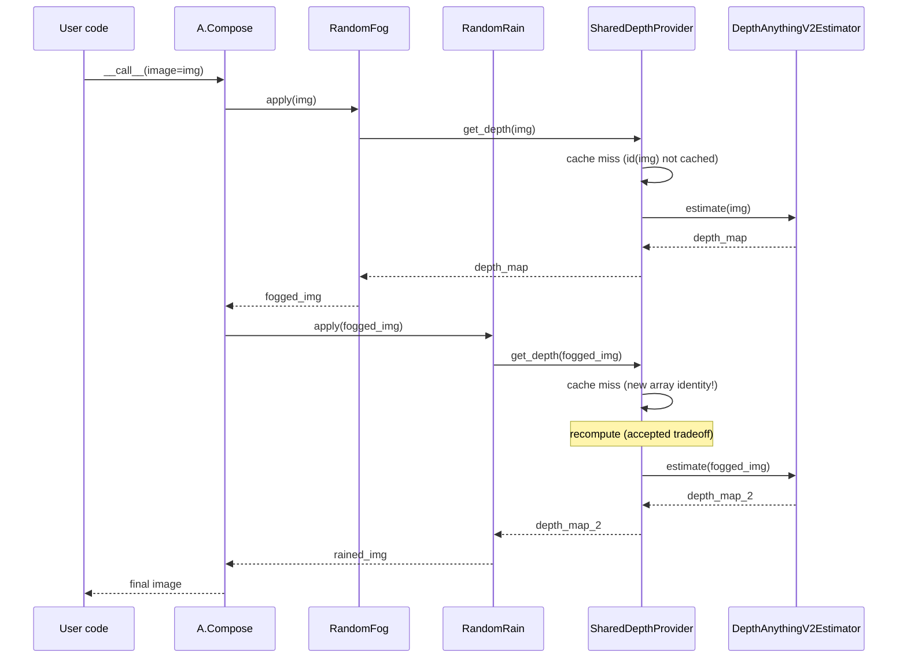
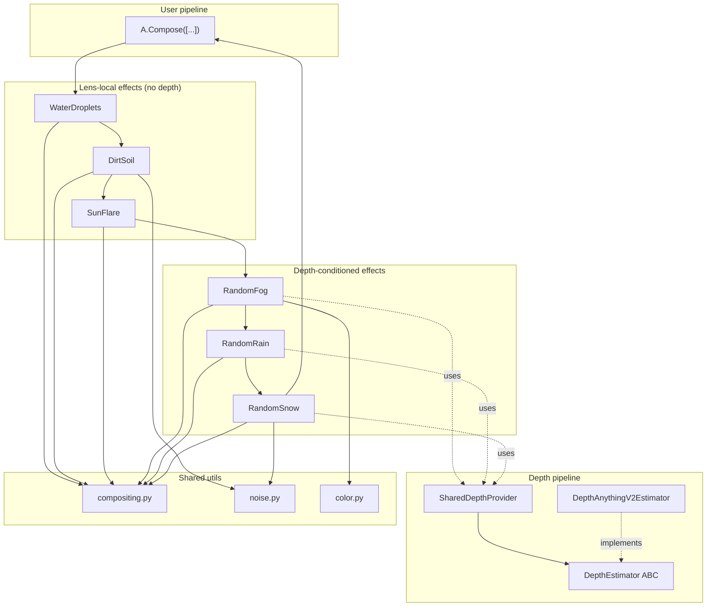

# weathermentations — implementation plan

Albumentations-compatible transforms for physically-grounded weather and lens
artifacts (fog, rain, snow, water droplets, dirt/soil, sun flare), for use as
training-time robustness augmentation.

## 1. Goals & non-goals

**Goals**
- Drop-in Albumentations `ImageOnlyTransform` subclasses, usable inside any
  `A.Compose([...])` pipeline.
- Physical models grounded in real formulas/papers, not ad-hoc filters —
  every effect's docstring cites the model it implements.
- Fast enough to run per-sample in a `DataLoader` worker for the depth-free
  effects; depth-conditioned effects require a GPU and say so loudly.
- Diverse, randomizable outputs suitable for robustness training, not
  necessarily indistinguishable from real photographs.

**Non-goals (v1)**
- Photoreal, production VFX-grade rendering.
- CPU-only depth estimation fallback (hard GPU requirement instead).
- Downstream robustness benchmarking (train/eval loops) — realism is
  validated visually and via unit invariants, not via a trained model's
  accuracy curve.
- Geometric transforms — nothing here moves pixels' semantic content, so no
  `DualTransform`/mask/bbox handling is needed.

## 2. Architecture

### 2.1 Package layout

```
weathermentations/
  __init__.py
  base.py                    # shared base classes / mixins
  depth/
    __init__.py
    estimator.py             # DepthEstimator ABC + DepthAnythingV2Estimator
    provider.py               # SharedDepthProvider (per-call cache)
  lens/
    water_droplets.py
    dirt.py
    sun_flare.py
  atmosphere/
    fog.py
    rain.py
    snow.py
  presets/
    severity.py               # SEVERITY[1..5] preset dicts per transform
  utils/
    color.py                  # airlight/atmospheric color estimation
    noise.py                  # perlin/simplex helpers for blob & flake shapes
    compositing.py             # alpha-composite, streak DB helpers
tests/
  unit/                        # physical-invariant tests
  visual_regression/
    golden/                    # fixed-seed reference PNGs
  qualitative/                 # notebooks/scripts comparing vs reference datasets
docs/
  examples/                    # generated sample images for README/docs
pyproject.toml
LICENSE                        # MIT
.github/workflows/ci.yml
.github/workflows/publish.yml
```

### 2.2 Base conventions

- Every transform subclasses `albumentations.ImageOnlyTransform`. No effect
  in scope changes geometry, so masks/bboxes/keypoints pass through
  Albumentations' `Compose` untouched with zero extra code.
- Constructor parameters are physical quantities expressed as `(min, max)`
  ranges, matching existing Albumentations conventions (`RandomRain`,
  `RandomFog`). A `p` argument controls the transform's own apply
  probability, as usual.
- `weathermentations.presets.SEVERITY[level]` (`level` 1–5, ImageNet-C
  style) returns a dict of kwargs per transform class that can be unpacked
  into its constructor — a convenience layer on top of the range API, not a
  separate code path inside the transforms themselves.
- Randomness goes through Albumentations' own `random_utils` /
  `self.random_generator` (per the modern Albumentations RNG API) so that
  global/pipeline seeding (`A.Compose(..., seed=...)`) controls these
  transforms exactly like built-in ones.
- torch is a hard dependency for the whole package (not just depth-aware
  transforms) — one code path, no optional-import branching.

### 2.3 Depth pipeline

- `DepthEstimator` is a small ABC: `estimate(image: np.ndarray) -> np.ndarray`
  (returns a relative depth map, same H×W, float32, larger = farther).
- `DepthAnythingV2Estimator` (small checkpoint) is the shipped default
  implementation, loaded via `transformers`/`timm`, `.eval()`, `cuda`-only.
- At construction, any depth-conditioned transform checks
  `torch.cuda.is_available()` and raises a clear, actionable error
  (`RuntimeError` with install/hardware guidance) if no CUDA device is
  present — no silent CPU fallback, since CPU inference would blow the
  training-step time budget this library exists to respect.
- **Sharing within one `Compose()` call**: depth is *not* cached across
  epochs/calls (decided against — no stable per-image id is available from
  a raw Albumentations call). Instead, a `SharedDepthProvider` instance is
  constructed once by the user and passed into every depth-conditioned
  transform's constructor (`RandomFog(..., depth_provider=dp)`,
  `RandomRain(..., depth_provider=dp)`, ...). Internally it holds a
  `maxsize=1` cache keyed on `(id(image), image.shape)`: the first
  depth-conditioned transform in the chain computes depth and caches it: any
  other depth-conditioned transform later in the same `Compose` call reuses
  it as long as the array identity hasn't changed. If an earlier transform
  in the chain happens to copy the array (cache miss), depth is simply
  recomputed — a graceful perf degradation, not a correctness bug, and an
  explicitly accepted tradeoff from the caching-strategy decision.
- Depth values are relative (unitless); each depth-conditioned effect maps
  them into its own physical parameterization (e.g. fog's `beta` expects
  depth pre-scaled by a user-provided `depth_scale` to pseudo-meters, since
  monocular relative depth has no absolute scale).



### 2.4 High-level module architecture



## 3. Effect specifications

### 3.1 v1, phase 1 — Lens artifacts (depth-free)

#### Water droplets (`lens/water_droplets.py`)
- **Model**: each droplet is a small refractive lens (spherical-cap
  approximation, refractive index of water ≈ 1.33). For each droplet:
  compute a local surface-normal field from an assumed hemispherical/
  ellipsoidal profile, refract the *sampling ray* per Snell's law to get a
  distorted UV lookup into the source image (produces the characteristic
  inverted/magnified miniature-scene look inside a droplet), add a
  specular highlight (Blinn-Phong, single directional "sky" light), and
  darken the contact-line edge.
  Reference: droplet-as-lens models used in raindrop detection/removal
  literature (e.g. Qian et al. 2018 "Attentive GAN"; You et al. adherent
  raindrop modeling).
- **Params**: `droplet_count_range`, `droplet_radius_range` (px), `blur_range`
  for out-of-focus droplets, gravity `streak_probability` for
  elongated/sliding droplets.
- **Composite**: per-droplet distorted patch alpha-blended into the base
  image; streaks are a thin vertically-elongated variant of the same model.

#### Dirt / soil (`lens/dirt.py`)
- **Model**: dirt on/near the lens sits far outside the camera's depth of
  field, so it renders as a heavily defocused, low-contrast, semi-opaque
  smudge, not a sharp mask. Generate blob shapes via clustered Perlin/
  simplex noise thresholding (`utils/noise.py`), then apply a large-radius
  blur (Gaussian or a bokeh-shaped kernel) to the blob alpha mask before
  compositing a brownish/grayish tint with reduced local contrast/
  saturation under the mask.
- **Params**: `blob_count_range`, `blob_size_range`, `opacity_range`,
  `color_range` (dirt/soil hue-saturation bounds), `defocus_blur_range`.

#### Sun flare (`lens/sun_flare.py`)
- **Model**: physically-motivated compound flare, not a single glow blob:
  (1) a veiling-glare haze radiating from the light source position, (2) a
  ring/halo at a fixed radius from the source, (3) a chain of "ghost"
  images — scaled, recolored (chromatic-aberration-shifted) copies of a
  soft circular aperture shape placed along the line through the image
  center and the light source, at positions mirrored past the center
  (models internal lens-element reflections), (4) optional radial
  diffraction streaks (star pattern) from an iris-diaphragm approximation.
  Reference: Hullin et al. 2011, "Physically-Based Real-Time Lens Flare
  Rendering".
  This supersedes Albumentations' existing simple `RandomSunFlare` additive
  circle with a compound, physically-motivated render.
- **Params**: `flare_position` (random or fixed), `ghost_count_range`,
  `halo_radius_range`, `intensity_range`, `streak_probability`.

### 3.2 v1, phase 2 — Depth pipeline

See §2.3. Deliverables: `DepthEstimator` ABC, `DepthAnythingV2Estimator`,
`SharedDepthProvider`, CUDA-required guard with actionable error message,
depth-scale calibration helper (`utils` function mapping relative depth →
pseudo-metric depth given a user `depth_scale` or a heuristic default).

### 3.3 v1, phase 3 — Fog / haze (`atmosphere/fog.py`)
- **Model**: Koschmieder's atmospheric scattering law:
  `I(x) = I0(x)·t(x) + A·(1 − t(x))`, `t(x) = exp(−β·d(x))`, where `d(x)` is
  (scaled) scene depth from the shared depth provider, `β` is the
  scattering/extinction coefficient, and `A` is the airlight/atmospheric
  color (estimated from the brightest, most desaturated image region, or a
  fixed near-white default).
- **Params**: `beta_range`, `atmospheric_light_range` (RGB or None for
  auto-estimate), `depth_scale`.
- **Invariant to test**: as `d(x) → ∞`, `I(x) → A`, monotonically in `d`.

### 3.4 v1, phase 4 — Rain (`atmosphere/rain.py`)
- **Model**: Garg & Nayar-style streak rendering — streaks as thin,
  near-vertical (± wind-angle), motion-blurred, semi-transparent
  highlights, alpha-composited over the image; streak length/width/blur
  modulated by a per-streak assigned depth (nearer drops → longer, more
  blurred streaks; farther drops → thinner, and at large depth streaks
  merge into a soft rain-veil haze layer, similar in form to the fog model
  but with a lower, rain-specific `beta`). Optional ground-wetness pass:
  darken + add horizontal specular sheen to the lower image band.
  Reference: Garg & Nayar, "Vision and Rain" (IJCV 2007);
  "Photorealistic Rendering of Rain Streaks" (SIGGRAPH 2006).
- **Params**: `streak_density_range`, `streak_length_range`, `angle_range`
  (wind), `brightness_range`, `veil_beta_range`, `wetness_probability`.

### 3.5 v1, phase 5 — Snow (`atmosphere/snow.py`)
- **Model**: particle system of flake sprites (soft circular/star kernels),
  count and per-flake size/blur modulated by depth (nearer = larger,
  more motion-blurred; farther = smaller, denser). Least "clean physics" of
  the four — flake fall/accumulation isn't a simple radiative-transfer
  law — so accumulation is handled as a separate, explicitly heuristic
  pass: a soft brightness/desaturation overlay on the lower image band
  (proxy for upward-facing, snow-catching surfaces), documented as a
  heuristic, not a physical claim.
- **Params**: `flake_density_range`, `flake_size_range`, `fall_angle_range`,
  `motion_blur_range`, `accumulation_probability`,
  `accumulation_strength_range`.

## 4. Validation strategy

Applies to every effect, each phase's checklist includes all four:

1. **Unit tests on physical invariants** — e.g. fog's monotonic
   approach to `A` with depth; alpha-compositing never leaves `[0,255]`;
   droplet refraction UV lookups stay in-bounds; flare ghost positions
   fall on the light-source/center line. Deterministic, fast, run in CI.
2. **Visual regression snapshots** — fixed-seed, fixed-input golden PNGs
   per transform × a few representative parameter settings, pixel-diffed
   in CI to catch unintended rendering changes (stability, not realism).
3. **Qualitative comparison against reference datasets** — side-by-side
   grids vs. real-condition photos during development (RESIDE for fog,
   Rain100/Raindrop for rain, a snow-scene subset for snow) — by-eye sanity
   check, not automated.
4. **Documentation sample generation** — a script that renders each
   transform at a spread of parameter values into `docs/examples/`, used
   directly in the README/docs.

No downstream robustness-benchmark training loop is in scope for v1.

## 5. Build order & roadmap


## 6. Backlog (post-v1, documented not built)

- **Optical/sensor artifacts**: chromatic aberration, vignetting, lens
  distortion/bokeh, sensor noise/ISO grain, motion blur, JPEG compression —
  depth-free, camera-local, same family as phase 1.
- **Low-light/nighttime**: headlight/streetlight glare, underexposure +
  noise, bloom around light sources — often paired with rain/fog for
  "night rain" compound scenes.
- **Condensation/frost/mud**: windshield condensation (distinct from
  atmospheric fog), frost crystal patterns, mud/splash spatter — more
  niche, higher rendering complexity, lower reuse of existing
  depth/streak infrastructure.
- **Compound/combined presets**: a composition layer chaining v1 effects in
  physically correct order (e.g. atmosphere effects before lens effects) —
  depends on v1 effects existing first, not a new physical model.

## 7. Packaging & release

- Package name `weathermentations`, MIT license.
- `src/`-layout, `pyproject.toml` (PEP 621), Python ≥3.10.
- `albumentations>=1.4` (modern RNG API), `torch`, `transformers` or `timm`
  for the depth model, `opencv-python`/`numpy` for compositing.
- GitHub Actions CI: lint (ruff), type-check (mypy), unit tests, visual
  regression tests (skip/mark depth-dependent tests if no GPU runner).
- Versioning: SemVer, starting at `0.1.0` until the v1 effect set + API is
  stable.
- Publish workflow: GitHub Actions + PyPI trusted publishing, gated behind
  a manual release tag push — not automatic on every merge.

## 8. Implementation checklist

### Phase 0 — Repo & scaffolding
- [x] `git init`, `.gitignore`, `LICENSE` (MIT), `README.md` skeleton
- [x] `pyproject.toml` (src layout, deps, ruff/mypy config)
- [x] `weathermentations/` package skeleton per §2.1
- [x] `base.py`: shared conventions (range-param validation helpers, RNG
      access via Albumentations' `random_utils`)
- [x] CI workflow: lint + type-check + unit tests on push/PR
- [x] `tests/` scaffolding (`unit/`, `visual_regression/golden/`,
      `qualitative/`)

### Phase 1 — Lens artifacts
- [x] `utils/noise.py`: value-noise blob generator (`blob_cluster_mask`)
- [x] `utils/compositing.py`: alpha-composite + radial-falloff helpers
- [x] `WaterDroplets` transform: refraction model, specular highlight,
      contact-line darkening, gravity streaks
  - [x] unit tests (UV lookup in-bounds, alpha range)
  - [x] visual regression goldens
  - [ ] qualitative comparison pass (needs a reference droplet-photo set —
        deferred, not automatable without external data)
  - [x] doc sample images
- [x] `DirtSoil` transform: noise blobs, defocus blur, tint/contrast
      compositing
  - [x] unit tests, goldens, doc images
  - [ ] qualitative comparison pass (deferred, needs reference photos)
- [x] `SunFlare` transform: veiling glare + halo + ghost chain + optional
      diffraction streaks
  - [x] unit tests (ghost positions on source/center line), goldens,
        doc images
  - [ ] qualitative comparison pass (deferred, needs reference photos)

### Phase 2 — Depth pipeline
- [x] `DepthEstimator` ABC
- [x] `DepthAnythingV2Estimator` (small checkpoint, CUDA-only, clear error
      if no CUDA)
  - Verified empirically against a real photo: output correctly has
    larger=farther after the disparity inversion (nearest point — a cat's
    face pressed toward camera — is darkest in the depth visualization).
- [x] `SharedDepthProvider` with `maxsize=1` `(id(image), shape)` cache
- [x] depth-scale calibration helper (relative → pseudo-metric):
      `depth/scale.py::to_pseudo_metric`
- [x] unit tests: cache hit/miss behavior, error message on no-CUDA
- [x] provider-level test: two callers sharing one provider see consistent,
      non-recomputed depth (full integration test with real RandomFog/
      RandomRain transforms deferred to Phase 3/4 once those exist)

### Phase 3 — Fog
- [x] `RandomFog` (Koschmieder's law, airlight estimation or fixed `A`)
  - [x] unit test: monotonic approach to `A` with depth (plus zero-beta
        identity and saturated-beta-approaches-airlight invariants)
  - [x] goldens (using a deterministic fake depth estimator so the
        compositing-math golden test runs without a GPU)
  - [x] doc images
  - [ ] qualitative comparison pass vs. RESIDE samples (deferred, needs
        external data). Spot-checked instead against a real photo (not
        RESIDE): haze correctly appears only in the farther background,
        the near subject stays clear.

### Phase 4 — Rain
- [x] streak rendering (length/width/blur by depth), rain-veil haze layer,
      optional ground-wetness pass (feathered transition, not a hard seam)
  - [x] unit tests (alpha/transmission range, veil monotonicity, zero-density
        identity, feathered-seam check), goldens, doc images
  - [ ] qualitative comparison pass vs. Rain100/Raindrop samples (deferred,
        needs external data). Spot-checked instead on a real photo and a
        synthetic outdoor scene: streaks slant with wind angle, are denser/
        larger near the camera and fade to haze in the distance.
  - Bug caught during implementation, worth remembering: using
    `check_range_bounds` (designed for tuples) on a *scalar* float field
    doesn't raise a clean error — Albumentations' validation swallows it as
    a warning and silently resets **all** constructor args to their
    defaults, which then fails confusingly on any required arg with no
    default (here, `depth_provider`). Scalar `[0,1]`-type fields must use
    `pydantic.Field(ge=..., le=...)` instead; fixed retroactively in
    `WaterDroplets.streak_probability` and `SunFlare.streak_probability` too.

### Phase 5 — Snow
- [x] flake particle rendering (depth-modulated size/blur/motion-blur),
      heuristic accumulation overlay (explicitly documented in the module
      docstring as a heuristic — not derived from surface normals like a
      true physical accumulation model would need)
  - [x] unit tests (depth-scaled flake size, accumulation brightening,
        zero-density/zero-probability identities), goldens, doc images
  - [ ] qualitative comparison pass (deferred, needs external reference
        photos). Spot-checked instead on a synthetic outdoor scene: flakes
        are visibly larger near the bottom (closer) than near the top
        (farther); ground-accumulation brightening confirmed numerically
        (a flat mid-gray ground band brightened from 90→175 at 0.5 strength).

Reused/promoted during this phase: `_directional_blur_kernel` and the
feathered-band-blend pattern from rain.py were both needed again for snow,
so they were extracted into `utils/compositing.py` as
`directional_blur_kernel`/`feathered_band_blend` and rain.py was refactored
to use the shared versions instead of its own private copies.

### Phase 6 — Presets, docs, packaging, release
- [x] `presets/severity.py`: `SEVERITY[1..5]` dicts per transform, derived
      from the physical ranges above (density/opacity/beta/intensity knobs
      scaled 1→5; `p` and `depth_provider` intentionally excluded — pipeline
      wiring, not severity). Covered by `tests/unit/test_presets.py`
      (all 6 transforms × all 5 severities construct and run; fog severity
      verified monotonically denser).
- [x] doc sample-image generation script (`docs/examples/`) — covers all
      six v1 transforms
- [x] README: install, quickstart `Compose` example (depth-free *and*
      depth-conditioned), severity-preset usage, per-effect gallery table
- [x] finalize `pyproject.toml` metadata, versioning (keywords, Python
      3.10-3.12 classifiers; removed a placeholder GitHub URL that had been
      guessed rather than real — no git remote exists yet, so `project.urls`
      is left empty with a comment instead of a fabricated link)
- [x] PyPI publish workflow (`.github/workflows/publish.yml`): trusted
      publishing (OIDC, no stored API token), triggered only on a `v*` tag
      push or manual dispatch — never on a plain merge
- [ ] tag `v0.1.0`, first release — scaffolding is in place
      (`publish.yml`) but nothing has actually been tagged/pushed/published;
      that's a deliberate, user-triggered action outside this plan's scope
